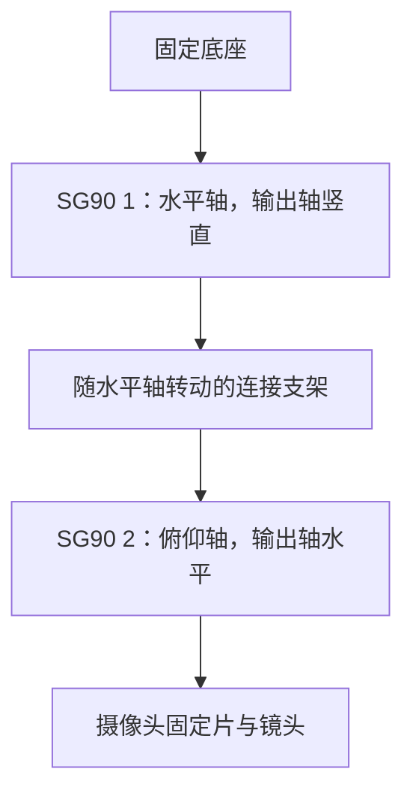

# 摄像头双轴自动对准：现有硬件实施说明

## 已确认的设备与资料

- 使用者确认：两只 SG90、双轴支架及 BF3901 已装好；底部水平轴接 P17，上部俯仰轴接 P18。独立稳压 5V 供电且与主板共地；2026-10-30 使用者再次确认电源已开启。实际转动方向及安全机械范围仍待验证。
- `C:/Users/jiawa/Desktop/黑客松/外设资料/2-舵机/舵机.pdf` 第 1 页列出 SG90，第 8～9 页给出接线与 PWM 说明；该文件同时收录多个型号，不能将 MG90/TS90 的电流参数套用到 SG90。
- 同目录上级的 `LJWB03_...pdf` 主板照片可见左侧 P17、P18。该文件是照片标注，不是完整官方电路图；以下引脚为候选，安装前仍应核对实物丝印和电气连接。
- 已有固件使用 GPIO4 作为摄像头 VSYNC/CS，不能再给舵机使用。SDK 的 `bsp_servo.h` 默认信号恰为 GPIO4，不能直接启用。

## 机械安装

两只角度型 SG90 可以组成两轴；实际装配还需要底座、两轴连接支架、舵盘和摄像头固定片。

优先使用适配 SG90 的双轴支架，或依照实物尺寸制作轻质刚性支架。摄像头靠近俯仰轴安装，转接板及线缆固定并留出松弛弯曲余量；排线和杜邦线不能承担结构重量或限制转角。没有支架时只能先验证两只舵机的空载控制，尚不能完成摄像头自动转向。

先让舵机停在电气中位，再安装舵盘并调整机械朝向。不要照搬资料中的最大行程，先使用有限的小范围，逐轴测出不会碰撞、绷线或顶住机械限位的工作范围。

## 候选接线

| 设备 | 信号线 | 正极 | 负极 |
| --- | --- | --- | --- |
| 水平 SG90 | 主控 GPIO17，对应照片 P17 | 独立稳压 5V | 外部电源 GND |
| 俯仰 SG90 | 主控 GPIO18，对应照片 P18 | 同一独立稳压 5V | 外部电源 GND |
| 主控 | 摄像头接线保持原样 | 继续通过 USB 供电 | 与外部电源 GND 相连 |

通常红线是正极，棕/黑线是负极，橙/黄/白线是信号，以实物线序为准。两只舵机共用电源时，电源与接线应能覆盖两只的启动和负载电流；资料中的 90mA 是空载值，不能作为整个供电系统的额定要求。不要给舵机接摄像头的 3.3V 电源，也不要直接把未核实的外部 5V 正极并到 USB 供电中的主控 5V。

候选 GPIO17/18 未出现在当前启用外设的占用配置中。当前摄像头占用 4、8、13、21、41、47；音频使用 38～40，串口使用 43/44，灯光使用 1，复位按键使用 14。

## 驱动改造

现有 `bsp_servo.c` 只有一份全局 `s_pwm`、目标角度和移动任务，不支持初始化两次得到两只独立舵机。

已在 HeadVoice 适配目录实现独立双轴驱动，官方 vendor 保持不变：

- 每轴各有 PWM 通道、GPIO、当前脉宽、目标脉宽、安全限位和方向配置。
- 直接使用 LEDC timer 0、channel 0/1，分别驱动 GPIO17/18。摄像头的可选 XCLK 预留 timer 3/channel 7，两轴不使用该定时器。
- 按资料使用 50Hz 控制；初始从 1500µs 中位开始，仅在 1000～2000µs 内作小幅空载验证，最终以实物校准结果收紧限位。脉宽和实际角度的对应关系需要实测。
- 默认上电不自动扫描；先通过明确的调试命令验证中位、两个方向、停止和限位，再允许自动对准。
- 两轴逐步移动，支持反向配置、超时停止与手动停止。俯仰轴停止移动后是否继续保持 PWM，应由实际承重测试确定。

## 自动居中算法

第一版采用“自动对准后锁定”。

1. 进入对准状态时暂停动作输入，清空未完成的组合和候选。
2. 图像旋转校正后，使用单人的双眼中点作为头部目标；同时检查人体、头部关键点是否有效。只有单个可用目标才移动。
3. 计算归一化偏差：`ex = (target_x - width / 2) / width`，`ey = (target_y - height / 2) / height`。宽高来自实际推理图像，不写死为传感器原始尺寸。
4. 先采用小步控制。偏差超出容差时，对相应轴小幅改变目标脉宽，等待机械稳定，再使用稳定后采集的新图像判断；方向通过逐轴实测确定。
5. 中心容差可先取画面宽高的 5%～10% 作为试验起点，依据实测调整。连续多个观察落入容差后停止转动。
6. 锁定摄像头位置，重新校准使用者的中立姿态，然后恢复动作识别。
7. 无人、多人、失去关键点、到达限位或超过对准时限时停止。需要重新对准时，由使用者或辅助者明确触发。

对准期间每次移动都会使已经在推理中的帧失去参考意义。控制器应只接受采集时间晚于最近一次移动稳定时刻的结果，避免追着旧图像来回摆动。

## 当前实际限制与验证顺序

- 摄像头 stage 1 已实测连续完整取帧，约 18.26Hz；这不是姿态推理速度。
- stage 2 初测每次推理约 2～3 秒，不能据此承诺流畅跟随。可以先做慢速、静态使用者自动对准；持续跟随需要更快的定位链路。
- 队列保留旧待处理帧的问题已修正，旋转校正和修复固件已烧录复测。确认段中非推理帧龄最高 129ms；推理耗时中位数仍为 2676ms，尚不能支持实时动作输入。实测见 `validation.md`。
- 当前有效动作帧龄上限仍为 400ms。不能为了使慢模型输出被接受而直接放宽这一限制，自动对准和动作识别应分别验证。

按以下顺序实施：确认角度型舵机与供电 → 单只空载中位和方向测试 → 双轴独立控制 → 安装支架和镜头 → 标定安全范围 → 静态人像小步对准 → 锁定后重新校准 → 最后验证是否影响动作识别。

## 已实现的调试入口

构建使用 `tools/build.py headvoice build --stage 2 --rotate-cw90 --gimbal`。该模式按需推理，不运行连续动作识别。上电 PWM 关闭；控制器范围为 1300～1700µs，每次手动增量最多 ±50µs。所有运动都需要观察支架实际响应，软件限位不能替代机械标定。

- `hv_gimbal status`：读取状态，不启动运动。
- `hv_gimbal pwm`：读取 PWM 配置并采样主控 GPIO 电平、完整高脉冲宽度和周期，同时报告最大采样间隔；不能证明舵机端收到信号或产生转矩。
- `hv_gimbal arm pan|tilt`：开启指定轴至 1500µs。
- `hv_gimbal jog pan|tilt <us>`：指定轴小步调整。
- `hv_gimbal probe`：一次定位，不启动运动。
- `hv_gimbal dir <pan> <tilt>`：设置已实测的反馈方向，各为 ±1。
- `hv_gimbal start`：两轴已开启且方向已设置后，最多 20 步、90 秒对准；眼睛中点连续三个新采样落在中心 ±0.08 内才完成。
- `hv_gimbal stop`：终止对准并关闭两路 PWM，支架可能失去保持力。

主机使用 `tools/gimbal_control.py --port COM3 <命令>`，先重新枚举端口，串口不可并发占用。方向配置不持久化，重启须重新校准。当前尚未完成方向标定和实物自动居中验收；不能把串口目标脉宽回报视为实际转动成功。
