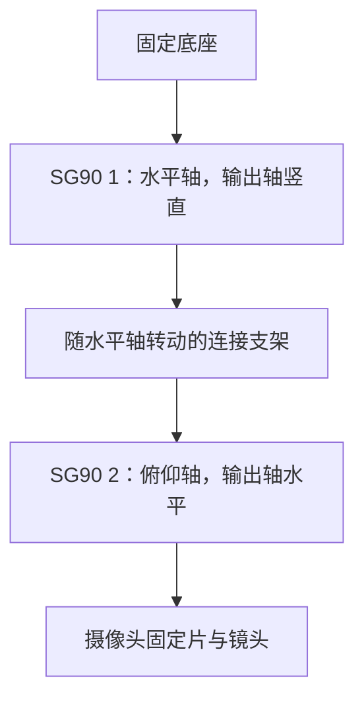

# 摄像头双轴自动对准：现有硬件实施说明

> 版本提示（2026-11-01）：本文中的“当前固件”描述当时的 face 云台试验版本。最近一次有记录的实机部署已改为 native 张掌／V 字手势版，`servo_control:false`，不包含自动居中；不能直接照本文的运动命令操作。日常操作见[用户使用说明](device-user-guide.md)，版本核对见[维护说明](device-maintenance-guide.md)。

## 2026-10-31 人脸后端集成固件与上板初测

此前的 `--gimbal` 模式会替换整条姿态应用，并固定使用 COCO 模型；它不能让 face stage 2 面板自动对准。现已在**同一条 face stage 2 推理链路**加入双轴控制：用检测到的脸框中心计算画面偏差，双眼仍只用于倾角；摄像头、RGB 面板和姿态诊断继续运行。集成镜像见 [`headvoice-face-autocenter-stage2-20261031.json`](../artifacts/headvoice-face-autocenter-stage2-20261031.json)。离线构建与主机测试通过，镜像已烧录且刷写哈希校验通过。启动日志确认 stage 2 face、云台 PWM 默认关闭，摄像头连续取帧；**真实自动居中尚未通过验收**。

当前固件上电时 P17/P18 的 PWM 都关闭，不会自行转动。P18 俯仰轴的 `arm → jog +25 → jog -25 → stop` 已获使用者目视确认：上方舵机与摄像头支架一起小幅转动，无异常。随后 P17 水平轴在持续串口会话中执行 `1500 → 1525 → 1500 → 1475 → 1500 µs → stop`，使用者目视确认底部舵机带支架水平往返；两轮最终状态均为双轴 PWM 关闭、脉宽回到 1500 µs。**两轴手动小幅动作已验证，画面反馈方向、机械行程和闭环自动对准仍未验证。**P17 试动时 `people=0`，无法据此标定画面方向。证据见 `.local/face-gimbal-tilt-trial.jsonl`、`.local/face-gimbal-session-20261031-154848.jsonl`。

首轮幅度限制为 1475–1525 µs、单步最多 25 µs；输入结果帧龄不超过 400 ms，移动后只采纳稳定期之后的新帧。短暂丢脸时不继续移动；持续 1 秒没有有效新目标、超时、方向错误或触及限位时关闭两路 PWM。`arm`/`jog` 后空闲 10 秒会自动关输出；成功居中后最多保持 60 秒，再自动关输出。该脉宽范围只是初始小幅试动范围，尚未标定机械角度，不能承诺能把明显偏离画面的脸移到正中。

当前固件的串口命令为 `hv_gimbal status`、`target`、`arm pan|tilt`、`jog pan|tilt <signed_us>`、`dir <pan_sign> <tilt_sign>`、`start`、`stop`。`target` 只读返回最近新鲜脸框中心；手动微调后会等待稳定期与新采集帧，避免把移动前画面用来标定方向。`start` 要求双轴已 `arm` 且两个方向已显式设置。当前真人正脸检测仍间歇掉检，启动后可能安全停止，不能从软件回执推断支架已经自动居中。实机试动应先提醒观察者，逐轴核对实际转动、相机画面坐标变化、线材余量和停机状态。

**当前暂停常规舵机往返与自动居中试验，先校准启动位置。**2026-10-31 方向标定中，P17 的 +25 µs 位置未取得有效脸、−25 µs 位置取得有效脸，P18 目标回执被日志打断后工具停机。随后 `arm tilt 1500 µs → stop` 试验出现俯仰大幅下移，当时未能分辨发生时点；历史日志见 `.local/face-gimbal-direction-calibration-2.jsonl` 与 `.local/face-gimbal-tilt-return-1500.jsonl`。

用户随后亲自逐条测试，明确下移发生在 `arm tilt` 后，两次均到同一个偏低位置并稳定。对应 `.local/face-gimbal-session-20261031-160558.jsonl`、`.local/face-gimbal-session-20261031-160633.jsonl` 都记录了 `arm tilt` 后 `tilt_us=1500`，没有 `jog` 或自动 `start`。用户另确认断 USB 后没有明显自行下垂、排线有余量，上电后未发命令时不动。最新证据支持优先检查 1500 µs 与镜头朝向的对应关系，不再等待 arm/stop 时点定位；尚未测量舵机端电压，不能据此排除供电问题。最后一份手动日志没有停机回执，不能把此前试验的 PWM 关闭状态当作当前实机状态。

`arm` 是立即输出固定 1500 µs 的位置命令，不是保持当前位置或只移动 25 µs；`status` 中的脉宽也不是实际角度。优先在断电、托住支架后检查舵盘与支架安装，让已知的 1500 µs 位置对应镜头朝前；不要强拧输出轴，也不要带电拆装舵盘。当前没有软件 home 标定入口，不应靠盲目扩大 1475–1525 µs 范围寻找中位。无角度反馈时，脉宽渐变不能保证消除首次启用的跳转。机械中位校准后才恢复逐轴小幅试动与方向标定。

2026-10-31 后续离线修复：源码新增视觉 epoch 变化时只清目标缓存的接口，不因此直接关闭手动已开启的 PWM；固件 `start` 也要求稳定期之后、400 ms 内的新鲜单脸。模拟回归与完整 ESP-IDF 编译通过，独立[候选清单](../artifacts/headvoice-face-target-epoch-candidate-20261031.json)明确尚未烧录。随后该修复已与 HP 有效性修复一起合入[自检固件](../artifacts/headvoice-face-selftest-eligibility-20261031.json)并上板。两轮各 6 次只读状态均为 PWM 关闭，无运动命令；未进行自动居中或真实 start 门槛验收。本文开头的 d9db1f… 镜像与两轴试动属于此前历史。

## 已确认的设备与资料

- 使用者确认：两只 SG90、双轴支架及 BF3901 已装好；底部水平轴接 P17，上部俯仰轴接 P18。2026-10-31 使用者更正接线：两只舵机红色 5V 线焊在一起，共用开发板 5V/VBUS，并未使用独立稳压 5V。此前“独立供电已确认”的记录不适用于当前接法。两轴小幅带动支架已获目视确认；画面反馈方向、安全机械范围及承重停机行为仍待验证。
- `C:/Users/jiawa/Desktop/黑客松/外设资料/2-舵机/舵机.pdf` 第 1 页列出 SG90，第 8～9 页给出接线与 PWM 说明；该文件同时收录多个型号，不能将 MG90/TS90 的电流参数套用到 SG90。
- 同目录上级的 `LJWB03_...pdf` 主板照片可见左侧 P17、P18。该文件是照片标注，不是完整官方电路图；以下引脚为候选，安装前仍应核对实物丝印和电气连接。
- 已有固件使用 GPIO4 作为摄像头 VSYNC/CS，不能再给舵机使用。SDK 的 `bsp_servo.h` 默认信号恰为 GPIO4，不能直接启用。

## 机械安装

两只角度型 SG90 可以组成两轴；实际装配还需要底座、两轴连接支架、舵盘和摄像头固定片。

优先使用适配 SG90 的双轴支架，或依照实物尺寸制作轻质刚性支架。摄像头靠近俯仰轴安装，转接板及线缆固定并留出松弛弯曲余量；排线和杜邦线不能承担结构重量或限制转角。没有支架时只能先验证两只舵机的空载控制，尚不能完成摄像头自动转向。

先让舵机停在电气中位，再安装舵盘并调整机械朝向。不要照搬资料中的最大行程，先使用有限的小范围，逐轴测出不会碰撞、绷线或顶住机械限位的工作范围。

## 当前接线

| 设备 | 信号线 | 正极 | 负极 |
| --- | --- | --- | --- |
| 水平 SG90 | 主控 GPIO17，对应照片 P17 | 与俯仰舵机红线焊接后接主板 5V/VBUS | 主板 GND，待实物复核 |
| 俯仰 SG90 | 主控 GPIO18，对应照片 P18 | 与水平舵机共用主板 5V/VBUS | 主板 GND，待实物复核 |
| 主控 | 摄像头接线保持原样 | 当前通过 Mac USB 供电 | 主板 GND |

通常红线是正极，棕/黑线是负极，橙/黄/白线是信号，以实物线序为准。当前两只舵机共用开发板 5V/VBUS，舵机端电压和 USB 供电余量尚未实测；不能因主控没有 brownout 日志就判定舵机端稳定。资料中的 90mA 是空载值，不能作为整个供电系统的额定要求。若后续改用外部 5V，应先确认共地和主板供电隔离，不能直接把未核实的外部 5V 正极并到 USB 供电中的主控 5V。

GPIO17/18 未出现在当前启用外设的占用配置中。当前摄像头占用 4、8、13、21、41、47；音频使用 38～40，串口使用 43/44，灯光使用 1，复位按键使用 14。

## 驱动改造

现有 `bsp_servo.c` 只有一份全局 `s_pwm`、目标角度和移动任务，不支持初始化两次得到两只独立舵机。

已在 HeadVoice 适配目录实现独立双轴驱动，官方 vendor 保持不变：

- 每轴各有 PWM 通道、GPIO、当前脉宽、目标脉宽、安全限位和方向配置。
- 直接使用 LEDC timer 0、channel 0/1，分别驱动 GPIO17/18。摄像头的可选 XCLK 预留 timer 3/channel 7，两轴不使用该定时器。
- 按资料使用 50Hz 控制；当前集成固件从 1500µs 中位开始，只允许 1475～1525µs。脉宽和实际角度的对应关系需要实测。
- 默认上电不自动扫描；先通过明确的调试命令验证中位、两个方向、停止和限位，再允许自动对准。
- 两轴逐步移动，支持方向配置、超时停止与手动停止。`stop` 关闭两路 PWM；闭环判定居中后最多保持 PWM 60 秒，实际承重效果仍待测试。

## 自动居中算法

当前集成固件采用“显式启动、小步对准、居中后限时保持”。闭环本身还没有完成实物验收。

1. 上电 PWM 关闭；`status` 与 `target` 均为只读。两轴实际小幅转动已确认，下一步需从有效单脸画面逐轴确认坐标反馈方向，再逐轴 `arm` 并设置两个方向，最后显式发送 `start`。
2. 图像旋转校正后，使用单张有效人脸的**检测框中心**作为目标；双眼关键点用于姿态倾角及人脸有效性检查，不作为云台的目标坐标。
3. 脸框中心先按实际推理图像宽高归一化到 0～1；控制器计算 `ex = target_x - 0.5`、`ey = target_y - 0.5`，不写死传感器原始尺寸。
4. 偏差超出中心容差 ±0.08 时，选择偏差较大的轴，最多移动 25 µs；移动后等待 450 ms 稳定，并只接受此后采集的新帧。连续 3 个新观察都落在中心容差内，才报告居中。
5. 短暂无人、多人、掉检或旧帧时等待，不继续移动；超过 1 秒没有可用的新目标，或达到 20 步、90 秒、脉宽限位、错误反馈方向时，关闭两轴输出。居中后最多保持 60 秒，`stop` 可立即关闭两轴输出。
6. 闭环结束后是否需要重新校准中立姿态，以及是否恢复 stage 3 动作识别，仍属后续集成工作；当前 stage 2 没有完成这项验收。

对准期间每次移动都会使已经在推理中的帧失去参考意义。控制器应只接受采集时间晚于最近一次移动稳定时刻的结果，避免追着旧图像来回摆动。

## 当前实际限制与验证顺序

- 摄像头 stage 1 已实测连续完整取帧，约 18.26Hz；这不是姿态推理速度。
- 早期 stage 2 初测每次推理约 2～3 秒；后续 face 后端在取景合适时出现过连续有效人脸观察，但仍有间歇掉检，尚不能据此承诺稳定跟随。当前闭环只适合先做静态、小幅试验；持续跟随需要更稳定且及时的定位输入。
- 队列保留旧待处理帧的问题已修正，旋转校正和修复固件已烧录复测。确认段中非推理帧龄最高 129ms；推理耗时中位数仍为 2676ms，尚不能支持实时动作输入。实测见 `validation.md`。
- 当前有效动作帧龄上限仍为 400ms。不能为了使慢模型输出被接受而直接放宽这一限制，自动对准和动作识别应分别验证。

下一步先在支撑支架的前提下确认断电下垂、舵盘固定、排线余量和舵机供电，再决定是否恢复逐轴试验。机械与供电问题解决后，才按“稳定单脸目标 → 逐轴反馈方向 → 安全机械范围 → 静态小步对准 → 停止与掉检保护”的顺序验证；进入 stage 3 前还需重新校准中立姿态。

## 已实现的调试入口

**当前已烧录的 face stage 2 集成固件**上电 PWM 关闭；脉宽范围 1475～1525 µs，每次手动增量最多 ±25 µs。所有运动都需要观察支架实际响应，软件限位不能替代机械标定。

- `hv_gimbal status`：读取状态，不启动运动。
- `hv_gimbal target`：只读查看最近单脸目标坐标、帧龄与有效性。
- `hv_gimbal arm pan|tilt`：开启指定轴至 1500µs。
- `hv_gimbal jog pan|tilt <signed_us>`：指定轴调整不超过 25 µs，不能越过 1475～1525 µs。
- `hv_gimbal dir <pan> <tilt>`：设置已实测的反馈方向，各为 ±1；要求两轴已 `arm`。
- `hv_gimbal start`：两轴已开启且方向已设置后，最多 20 步、90 秒对准；脸框中心连续三个新观察落在中心 ±0.08 内才完成。
- `hv_gimbal stop`：终止对准并关闭两路 PWM，支架可能失去保持力。

在 Mac 上调试时使用 `tools/face_gimbal_session.py --port /dev/cu.usbmodem实际编号`，它保持一条串口连接、等待启动后的安全状态、按顺序接收命令；损坏的只读 `target` 回执可有限重试，运动命令不会重发。方向配置不持久化，重启后须重新校准。**目前因俯仰支架大幅下移暂停所有运动命令；仅可在支架安全固定后使用只读 `status`、`target`。** `hv_gimbal pwm`、`probe`、`tools/gimbal_control.py --port COM3` 及 1300～1700 µs 限位属于旧的独立 `--gimbal` 诊断模式，不能用作当前集成固件的命令或限位。当前尚未完成方向标定和实物自动居中验收；不能把串口目标脉宽回报视为实际转动成功。
