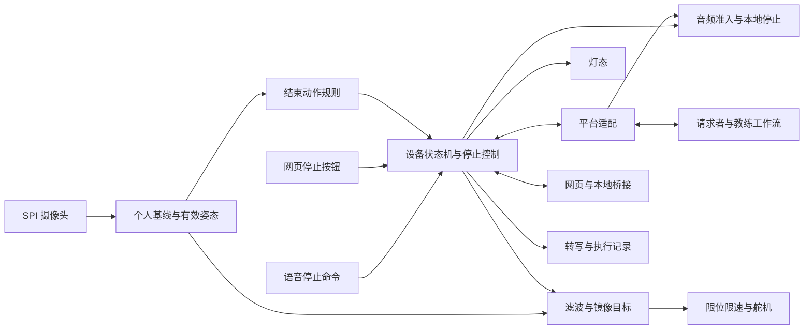
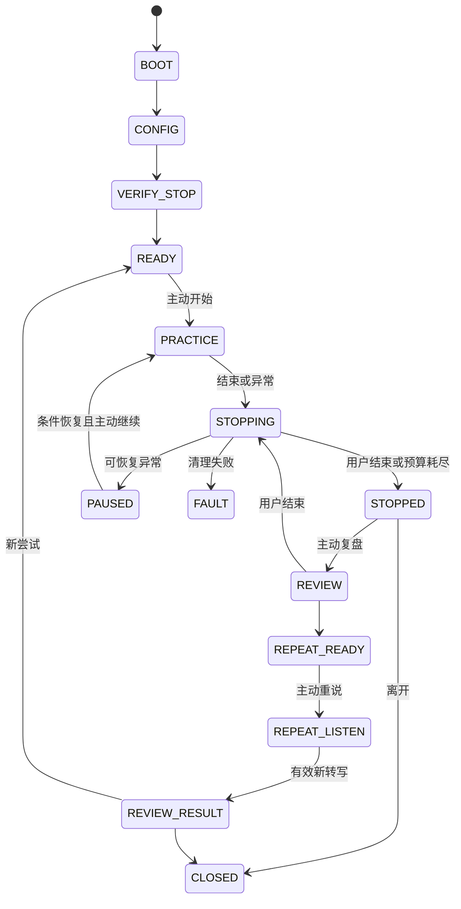

# 退场教练 ExitCoach 软件开发文档

版本：v1.0  
日期：2026-10-24  
状态：开发设计，尚未实现或通过实机验收  
适用代码基线：`ljyd_xjwb03_agent_public_developer`，提交 `89020f5e04bf777ae1672b8f3d320bc6e0ef3e0c`

## 1. 目标、范围与完成条件

ExitCoach 用一个可随时结束的对话场景，帮助使用者练习拒绝、暂停和结束对话。设备识别事先约定的结束动作，停止角色声音和镜像，随后由使用者决定复盘、重练或离开。复盘引用本轮真实转写，最终落实为使用者重新说出一句话。

需求依据为 [AI硬件黑客松-双方案完整实现方案.md](/Users/emt/Workspace/hackathon/AI硬件黑客松-双方案完整实现方案.md) 的 ExitCoach 与共用开发安排。本文与 [HeadVoice 软件开发文档](/Users/emt/Workspace/hackathon/HeadVoice_软件开发文档.md) 共用设备能力边界，分别定义产品流程。用户已说明时间相对宽裕，两方案均可实施；阶段按依赖划分，不沿用原方案的现场小时排期。

本文的 **需求**来自原方案；**设计决定**是本版推荐实现；**已核实**表示源码或配置中存在；**待验证**需要平台、编译、硬件或使用测试。`ec.*` 消息、模块和接口均为项目拟定契约，不是已经验证的官方 API。

### 1.1 功能范围

| ID | 需求与本版范围 | 完成证据 |
|---|---|---|
| EC-01 | 同事临时要求加班的场景，轻度/中度两种难度，允许至少两轮互动 | 实际转写、角色发言与轮次记录 |
| EC-02 | 个人中立校准、自定义结束动作、开始前实际验证 | 动作规则版本和试做停声记录 |
| EC-03 | 动作、语音“结束模拟”、网页按钮汇入同一停止逻辑 | 三种入口分别实际停止 |
| EC-04 | 设备本地先停止，停声不等待模型或网络 | 生成中、播放中、断网时的实测 |
| EC-05 | 清空待播任务，停止后旧角色音频不重新进入 | 迟到、重复、重连与恢复测试 |
| EC-06 | 至少单轴镜像，并逐步完成侧倾和转头展示；可关闭镜像 | 方向、限位、限速、回正与持续运行记录 |
| EC-07 | 配置蓝、演练红、结束绿、异常黄 | 状态与设备灯态一致 |
| EC-08 | 轻度最多一次追问，中度最多两次；每次最多三次请求者发言或 90 秒 | 边界和超时测试 |
| EC-09 | 用户选择后复盘，引用真实原话，每次一处改进、最多两个候选句 | 引用关联和复盘记录 |
| EC-10 | 用户选择句子后真实重说，可主动重练或离开 | 新录入的转写及对应步骤 |
| EC-11 | 请求者演练、教练复盘两个平台工作流 | 真实输入、输出和设备执行回执 |
| EC-12 | 网页设置、动作约定、逐句记录、停止按钮与调用时间线 | 网页与设备同步及断连处理 |
| EC-13 | 追踪丢失、断网、重启和模式切换后不自动续播 | 故障注入与实机恢复记录 |
| EC-14 | 个人动作样本、明确标签纠正、独立验证和回退；学习不能压过结束规则 | 更新前后测试及结束信号回归 |
| EC-15 | 最小练习记录、配置恢复和退出清理 | 记录字段、保存选择和重启检查 |

原方案一处写“首版展示侧倾和转头”，交付清单又规定“至少单轴镜像”，并将第二轴连续镜像列为扩展。本版保留这些层级：先通过单轴基础验收，再完成侧倾/转头展示；第二轴可先采用三档平滑动作，连续双轴跟随另行验收。单轴通过不能记为双轴完成。

个人学习列入开发范围，安排在可靠退出和完整复盘之后。日常姿态提醒默认关闭，属于可选学习演示；更多场景、跨次练习历史和俯仰轴属于扩展。演练期间不做坐姿纠正，也不从姿态推测心理状态。

### 1.2 全程必须成立的约束

1. 任何有效结束信号都优先于生成、播报、镜像、学习和保存，不要求再次确认。
2. 结束动作在保持达标时立即触发，**不等待回正**；回正只用于下一次布防。
3. 网络取消失败、SDK 返回成功或界面变绿，都不能单独证明喇叭已经停声。
4. 已停止状态持续到用户明确选择下一步；恢复网络、出现新帧或收到迟到回调不能恢复演练。
5. 复盘由新权限启用教练输出，旧请求者输出始终失效；重练创建新的尝试。
6. 不为了完成“两轮对话”而拒绝提前结束，不为了复盘而强制解释、道歉或继续说话。
7. 引用来自可追溯的用户转写；模型生成、截断文本和缺失内容不能冒充原话。
8. 学习更新不能自动修改已约定的结束动作，也不能让“普通表达动作”的判断否决结束信号。

## 2. SDK 基线与实现缺口

SDK 根目录：`/Users/emt/Workspace/hackathon/ljyd_xjwb03_agent_public_developer`。

| 能力 | 已核实的入口/行为 | 需要补充或验证 |
|---|---|---|
| 启动与开关 | [main.c](/Users/emt/Workspace/hackathon/ljyd_xjwb03_agent_public_developer/apps/main/main.c)、[qm_config.h](/Users/emt/Workspace/hackathon/ljyd_xjwb03_agent_public_developer/apps/main/qm_config/qm_config.h)：姿态 1、摄像头 0，外设示例未启用 | 注册 ExitCoach 服务；开关、构建和初始化保持一致 |
| 视觉输入 | [example_pose.c](/Users/emt/Workspace/hackathon/ljyd_xjwb03_agent_public_developer/apps/main/pose/example_pose.c)、[bsp_camera.c](/Users/emt/Workspace/hackathon/ljyd_xjwb03_agent_public_developer/apps/main/peripheral/bsp_camera.c)：静态图示例与摄像头帧统计路径 | 接通连续推理、时间戳、缓冲所有权及有效性 |
| 姿态结果 | [yolo11_pose.cpp](/Users/emt/Workspace/hackathon/ljyd_xjwb03_agent_public_developer/apps/main/pose/yolo11_pose.cpp)、[yolo11_pose.h](/Users/emt/Workspace/hackathon/ljyd_xjwb03_agent_public_developer/apps/main/pose/yolo11_pose.h)：现有 yaw/roll 为无符号二维比例 | 增加方向、人数和关键点质量；不直接当真实头部角度 |
| 实际模型 | 当前选用 V1 的输入元数据为 `[1,192,192,3]`，见 [模型核查记录](/Users/emt/Workspace/uni_vault/06_LLM_Wiki/records/hackathon/HeadVoice_ExitCoach_代码缺口_2026-10-24.md) | 测当前板上的速度和可分性；不照搬 640×640 耗时 |
| 语音事件 | [agent_app.c](/Users/emt/Workspace/hackathon/ljyd_xjwb03_agent_public_developer/apps/main/agent/agent_app.c) 记录 ASR/TTS/文本与播放事件 | 关联业务尝试、角色、发言和实际播放状态 |
| 文本通知 | [qm_agent_event.h](/Users/emt/Workspace/hackathon/ljyd_xjwb03_agent_public_developer/qumios-dev/components/qm_agent/include/qm_agent_event.h) 含 `final`、`truncated`、`agent_id`、可用时的请求/代数 | 完整转写和会话绑定；通知不含 PCM，不能在此处完成音频入口拦截 |
| 应用中断 | [agent_app_abort_output](/Users/emt/Workspace/hackathon/ljyd_xjwb03_agent_public_developer/apps/main/agent/agent_app.c:474) 调用中断，`-QM_ENOSYS` 时投递允许后续音频进入的兼容事件 | 停止后保持独立的输出禁止状态，不能直接复用“下一句可继续”的语义 |
| 核心中断 | [interrupt_session](/Users/emt/Workspace/hackathon/ljyd_xjwb03_agent_public_developer/qumios-dev/components/qm_agent/src/core/qm_agent_core.c:1911) 检查传输可用性，再中止本地流并取消 TTS | 网络不可用等提前返回路径不能阻止本地停止；需独立适配 |
| 音频流 | [qm_agent_audio_engine.c](/Users/emt/Workspace/hackathon/ljyd_xjwb03_agent_public_developer/qumios-dev/components/qm_agent/src/audio/qm_agent_audio_engine.c) 有代数、准入关闭和清理机制 | 与产品的输出代数和角色权限对齐，并验证所有播放入口 |
| 喇叭停止 | [vb701n_proto_stop_audio](/Users/emt/Workspace/hackathon/ljyd_xjwb03_agent_public_developer/qumios-dev/drivers/VB701N/src/vb701n.c:287) 发送本地 STOP_AUDIO，并改变录音相关状态 | 实测缓冲清理和停声；不能绕过音频管理层直接混用，后续麦克风恢复也要检查 |
| 资源播放 | [playback.h](/Users/emt/Workspace/hackathon/ljyd_xjwb03_agent_public_developer/apps/main/lj_components/playback/playback.h) 声明文件/URL 播放和停止 | 停止最近操作不等于清空业务待播队列；补统一调度 |
| 舵机 | [bsp_servo.c](/Users/emt/Workspace/hackathon/ljyd_xjwb03_agent_public_developer/apps/main/peripheral/bsp_servo.c)、[bsp_servo.h](/Users/emt/Workspace/hackathon/ljyd_xjwb03_agent_public_developer/apps/main/peripheral/bsp_servo.h)：一路 PWM、渐进运动 | 动作映射、安装中位、较小软件限位、第二通道和状态控制 |
| 引脚 | 舵机 GPIO4 与 [摄像头 CS GPIO4](/Users/emt/Workspace/hackathon/ljyd_xjwb03_agent_public_developer/apps/main/peripheral/bsp_camera.h:37) 冲突 | 先核对原理图和空闲引脚再改接，不能同时启用默认接线 |
| 平台消息 | [ljyd_method.c](/Users/emt/Workspace/hackathon/ljyd_xjwb03_agent_public_developer/apps/main/cloud/ljyd_method.c) 已有 chat/quit、player/play 分发 | 自定义结构化工作流、角色切换和关联字段均待验证 |

以上只证明源码存在相应部分，不证明已满足 300 ms、离线停止或双轴镜像。

## 3. 总体架构与共用边界

### 3.1 模块职责

**设计决定：设备拥有停止状态、时间与轮次上限，以及音频最终执行权。** 平台负责语言流程，网页负责展示和用户操作。角色提示词不能代替设备限制。



| 层 | 推荐实现 | 责任 |
|---|---|---|
| 设备核心 | 可在电脑运行的纯 C | 状态、停止裁决、预算、消息校验、转写关联 |
| 设备适配 | C/C++，复用 ESP-IDF/QUMIOS | 摄像头、音频、RGB、舵机、存储和传输 |
| 网页与 bridge | TypeScript；沿用 HeadVoice 的 React＋Vite 与本地串口桥接设计 | 设置、停止、记录、时间线；不默认承担视觉推理 |
| 平台 | 两个独立角色/工作流 | 请求者演练、教练复盘；实际接入能力在 S0 核实 |
| 学习与评测工具 | Python；小型分类器再适配设备 | 特征评测、独立测试、报告与版本比较 |

框架版本在创建工程时锁定；本文不表示这些工程或依赖已经存在。

### 3.2 与 HeadVoice 共用什么

共用摄像头帧、校准格式、有效性、时间戳、特征窗口、音频适配、反馈驱动、协议外壳与诊断工具。结束识别与 HeadVoice 的动作完成事件分别实现：HeadVoice 等保持和回正才消费编码；ExitCoach 保持达标即停止。

两个产品分别维护词典/演练状态、确认含义、样本模式和版本。共用音频管理器必须只有一个活动产品所有者。切换产品时先关闭旧输出权限、停止音频、失效化旧回调并清空动作，再授权新产品；不能用 HeadVoice 的重新布防恢复 ExitCoach 的请求者。

## 4. 核心使用流程

### 4.1 配置、约定与验证

1. 用户设置目标和难度，例如“练习拒绝同事让我今晚加班，轻一点”。平台一次只追问一个问题。
2. 校准舒适中立姿态、镜像方向和一个明确的结束动作。动作幅度、方向和保持时间形成 `StopRule`。
3. 回读动作约定，使用者确认。默认示例可为约 0.8 秒保持，实际参数以个人能力和识别结果为准。
4. 播放一段明确标为测试的短音频，使用者试做动作，检查停声、绿灯和回正；语音与按钮也分别可用。一次试做只用于进入演练，不替代正式识别率验收。
5. 测试失败留在验证页面；通过后等待中立和用户主动“开始”，再创建新的演练尝试。

重启、变更结束规则、重新校准、改变安装方向或相关识别版本后重新验证。关闭镜像不关闭结束检测。无可用结束动作时可以诊断其他停止入口，但不能声称 EC-02 已完成。

### 4.2 演练与结束

请求者提出请求 → 用户回应 → 根据难度追问 → 用户回应。任一时刻的有效动作、语音或按钮结束都立即进入本地停止路径。提前结束也是合法结果，不要求补足轮次。

停止后首先展示“演练已结束”，提供“复盘／直接离开”。不自动开始教练长篇解释，不继续播放请求者的结束语；必要的操作提示只能在旧音频清理完成后以新的引导权限播放。

### 4.3 复盘、重说与重练

1. 用户选择复盘，冻结本次可用转写，切换到教练上下文。
2. 教练引用一段可核对的用户原话，指出一个已经表达清楚的部分，询问想修改的一处。
3. 用户选择目标；教练给出最多两句建议，用户可以选择、修改或不用。
4. 用户主动进入“重新说一次”，实际开麦并说话。只有这一步产生的有效新转写才算完成重说。
5. 用户可自评，并选择“同场景重练／到这里”。重练创建新 `attempt_id`，预算重新开始，旧角色和音频不会复活。

用户不说、取消或识别失败时，记录为未完成/待重试；不能用候选句文本自动填充“我重新说了”。复盘期间仍可用三种停止入口中止教练输出并回到选择页面。

### 4.4 异常暂停与主动继续

持续追踪无效、多人、断网或显示连接失效进入暂停，并使用同一音频清理机制。条件恢复后只提示可继续；用户选择“继续本次”时，在剩余预算内创建新的输出代数，丢弃被打断的旧句，等待用户输入后才请求新句。没有剩余预算则结束本次。

以上预算适用于请求者演练。复盘异常暂停时保存复盘步骤；恢复后用户可重发当前教练请求，或重新主动打开重说录音，不重播旧音频，也不沿用演练的 90 秒截止时间。

“用户结束”与“异常暂停”不同：前者不提供悄悄续接原请求者的恢复操作，只能复盘、离开或明确发起新尝试。恢复不得绕过未完成的音频清理和动作重新布防。

## 5. 状态机、事件和对话预算

### 5.1 产品状态

| 状态 | 行为 | 主要出口 |
|---|---|---|
| `BOOT` | 初始化；默认关闭所有角色输出，恢复配置但不恢复演练 | `CONFIG` 或 `FAULT` |
| `CONFIG` | 目标、难度、校准、结束规则和镜像设置 | `VERIFY_STOP` |
| `VERIFY_STOP` | 独立测试音频与真实停止；停止测试属于本状态子流程 | 通过后 `READY`；失败留在本状态 |
| `READY` | 已验证，等待中立和明确开始 | `PRACTICE` |
| `PRACTICE` | 请求者说话/听用户/等待回复，设备维持预算 | `STOPPING` |
| `STOPPING` | 立即禁止新输出；异步完成停声、清队列和反馈 | `STOPPED`、`PAUSED` 或 `FAULT` |
| `STOPPED` | 演练已结束，仅展示复盘/离开；请求者持续禁止 | 用户选择后 `REVIEW` 或 `CLOSED` |
| `PAUSED` | 异常已中断输出，保存被暂停的阶段，等待条件恢复和用户决定 | 演练按剩余预算恢复，复盘按对应步骤恢复，或 `STOPPED` |
| `REVIEW` | 教练引用、问修改目标、给建议 | `REPEAT_READY`、`STOPPING` |
| `REPEAT_READY` | 用户确认选择，等待主动开麦 | `REPEAT_LISTEN` |
| `REPEAT_LISTEN` | 只收本步骤的新语音，不播放请求者 | `REVIEW_RESULT` 或取消 |
| `REVIEW_RESULT` | 对照新转写、收集自评，选择重练或离开 | `READY` 或 `CLOSED` |
| `CLOSED` | 释放本轮上下文、清理临时数据 | 用户主动开始新配置 |
| `FAULT` | 输出保持禁止，展示具体故障，不接受恢复播放 | 故障排除后重新验证 |

`STOPPING` 是实现状态：进入它的第一步已经结束了请求者的执行权限；不能等清理完成才设置“停止”。清理失败不切到可继续状态。



图为主路径；复盘暂停、测试停止和全局故障按表格及停止规则处理，不把验证音频误计为正式演练。

### 5.2 事件身份与优先级

关键事件绑定 `boot_id`、`product`、`mode_epoch`、`attempt_id`、`output_epoch` 和来源 ID。文本/音频再绑定 `actor`、`turn_id`、`request_id`。所有事件保留采集时间与接收时间。

优先级为：结束/故障 → 追踪或连接失效 → 超时与预算 → 明确用户选择 → 语音内容与平台结果 → 镜像与诊断。停止入口使用预分配事件或原子标志，不依赖普通队列尚有空间。事件过载时关闭输出并暂停，不能丢掉停止继续播放。

### 5.3 难度、轮次和时间

| 难度 | 初始请求 | 最多追加追问 | 请求者发言上限 |
|---|---|---|---|
| 轻度 | 1 次 | 1 次温和追问 | 2 次 |
| 中度 | 1 次 | 2 次追问 | 3 次 |

“一轮互动”指一次请求者发言及其后的用户回应；正常演示可完成至少两轮，提前结束不算故障。请求者的新发言由设备批准并预占一次额度，不能按网络重试增加或释放额度来绕过上限。被打断或播放状态不明的发言仍保守计入已用额度。

最后一次允许的请求说完后，可以继续听取用户回应；收到回应后结束，不再批准下一次请求。演练到 90 秒即停止。90 秒从用户主动开始计算，包含等待模型和演练异常暂停；“继续本次”不重置截止时间，明确重练才创建新预算。进入已停止或复盘后注销本次演练计时器，迟到的超时事件不能中断新教练阶段。

用户明确表达最终拒绝和结束时，角色输出应为 `END`，设备终止请求者，不为凑轮次继续施压。固定停止命令走独立控制路径；开放语言的结束语义由平台提供结构化结果，不能宣称具有与本地动作相同的延迟保证。

## 6. 本地停止、音频权限与旧结果拦截

### 6.1 停止顺序

一次有效停止按以下顺序处理；各硬件效果异步执行，不串行等待网络：

1. 在短临界区设置停止标志，关闭输出准入，记录 `stop_id` 与确认时间，递增 `output_epoch`，撤销当前角色、音频和镜像目标的执行权限。
2. 立即通知音频任务停止活动流、资源播放和排队任务；清除待执行的下载/合成回调。音频操作前再检查权限，避免已经出队的任务漏过停止。
3. 提交绿灯和已校准中位目标；镜像不再接受姿态新目标，回正走限速控制。
4. 并行尝试取消平台生成或离开旧会话，并记录实际结果。取消失败不重新开放本地输出。
5. 收集音频清理状态，转入已停止/暂停；异常时保持禁止输出并报告故障。

重复停止是幂等操作：同一次停止返回原结果，不连续增加代数或生成新提示音。进入新阶段后，属于旧阶段的重复控制请求不能结束新阶段；网页先同步快照再发新请求。

### 6.2 权限检查必须覆盖真正的音频路径

拟定 `OutputPermit` 包含产品、启动/尝试/输出代数、角色、请求和有效状态。准入至少检查三处：接受生成结果、创建播放操作、向下层写入音频帧。停止必须同时清理已进入下层和芯片缓冲的声音；仅拒绝后来的文字不够。

SDK 的 `QM_AGENT_EVENT_BASE` 不发布 PCM 数据，应用事件监听可以用于记录，不能作为唯一拦截点。需要在实际传输/音频适配路径接入产品权限，并复用 SDK 内部流代数处理已在途的数据。

**不能在迟到包到达时，直接给它填写“当前代数”。** 请求创建时就必须保存业务上下文，并建立 `agent_id/request_id/SDK generation → OutputPermit` 映射。复盘或重练前若无法区分旧音频与新音频，应销毁旧 transport/agent 上下文、等待清理完成并建立新实例；没有可证实的边界就保持静音，不能靠等待固定几秒猜旧流已结束。

### 6.3 SDK 中断的适配要求

- `agent_app_abort_output()` 可作为取消链路的一部分，但其“重新开放下行”兼容逻辑不能解除 ExitCoach 的禁止状态。
- `interrupt_session()` 在传输不可用或接口缺失时可能提前返回；本地音频停止必须有独立入口，不以传输可用为前提。
- `playback_stop()` 面向最近接受的资源操作，仍需取消业务队列、资源交接和迟到下载回调。
- 驱动存在 STOP_AUDIO，不等于已确认可在任意线程直接调用。通过音频所有者串行控制，核对 SDK 清理、芯片缓存与录音状态，避免状态互相覆盖。
- 收到停止命令回执只记为命令阶段完成；实际停声通过外部测量验收。运行时若无法确定清理状态，禁止启动下一段角色音频。

### 6.4 复盘和新尝试如何获得输出权

`STOPPED` 默认不允许请求者或教练输出。用户选择复盘后，先确认旧音频清理完成，再创建新 `output_epoch` 和仅属于 `COACH` 的权限。旧请求者即便收到正常完成或“可以继续”通知也不再获准。

重练创建新 `attempt_id`，重新检查结束规则验证状态和中立条件。停止复盘同样撤销教练权限；不能沿用已停止的权限继续朗读建议。

语音停止仅在当前可识别的用户输入中成立。首版用最终 ASR 的明确命令“结束模拟”触发，不把请求者回声、教练引用或未完成的中间转写当作用户控制。若 ASR 依赖云端，离线语音停止不能承诺；动作和本地可达按钮仍须独立有效。语音延迟应同时报告说完命令到 ASR 确认，以及确认到停声两段。

## 7. 视觉、结束动作与追踪暂停

### 7.1 有效输入

采集任务记录帧序号与采集时间；推理只保留有界的最新帧，避免积压。消费者完成前不得归还借用的摄像头缓冲。先检查格式、旋转和镜像，再计算相对个人基线的特征。

每帧至少输出人数、必要关键点有效性、方向特征、采集/完成时间和失败原因。无效、过旧、倒序、多人或人数未知时，当前保持计时立即清零；不沿用最后一帧填满时间。连续追踪丢失达到阈值则暂停音频和镜像，恢复后需要主动继续。

### 7.2 结束动作状态

`DISARMED → NEUTRAL_READY → HOLDING → STOP_LATCHED`。只在当前允许控制的阶段、已稳定中立且规则版本匹配时进入检测。达到方向/幅度阈值后积累有效保持；持续时间与最少有效观察均满足时发出停止，不等待动作完成或回正。

离开动作区或出现无效间隔时重置保持。一次长保持只产生一次停止；继续或重练前必须回到中立并重新布防。结束规则执行于镜像控制之前，镜像关闭、舵机故障或 kNN 判断为普通表达都不能屏蔽它。

| 参数 | 调试初值 | 说明 |
|---|---|---|
| 保持时间 | 800 ms | 原方案示例；按个人调整 |
| 中立稳定 | 300 ms | 启用和恢复前检查 |
| 最少有效保持观察 | 3 帧 | 与持续时间同时成立 |
| 最大有效帧间隔 | 400 ms | 超过即清零，不能虚构连续观察 |
| 持续追踪无效暂停 | 1000 ms | 调试初值；多人立即暂停 |
| 镜像目标有效期 | 300 ms | 过期不继续跟随旧目标 |

这些是设计初值，不是已适配硬件的参数。若实际推理频率不足，先优化模型/处理路径或调整经用户验证的规则；不能只放宽缺帧容忍来宣称满足原指标。需要分别报告动作开始到确认、确认到停声。

### 7.3 动作选择的能力边界

首先验证带方向的侧倾特征；当前无符号 yaw/roll 不能区分左右。水平转头需要额外特征或合适模型，并在当前摄像头、距离和光照下验证。选择使用者舒适、可重复且与自然交谈有区别的动作，不要求人人使用同一个方向或幅度。

规则对象保存特征版本、方向、进入/退出阈值、保持参数、安装方向与校准版本。修改后旧验证结果失效。一个稳定的约定动作足以完成退出功能；动作命名不能超过实际可测能力。

## 8. 舵机镜像、RGB 与硬件适配

### 8.1 映射与运动控制

对有方向的姿态特征做个人基线扣除、死区与滤波，归一化为 `u ∈ [-1,1]`。连续特征可映射为目标角度；只有左/中/右标签时使用三个已标定目标并平滑移动，不宣传成连续角度估计。

拟定映射为 `target = clamp(center + direction × gain × u, soft_min, soft_max)`；每次更新再限制变化量不超过 `max_speed × dt`。`center`、安装方向、软件限位和速度来自当前装配校准，不能直接套用头部角度或其他舵机的参数。

当前驱动使用 0～180 的软件角度，默认中位脉宽为 1450 μs；**回正不是简单写入角度 0**。驱动已有渐进移动，应用限速要与它协调，由单一舵机适配器持有最终目标。`bsp_servo_get_angle()` 根据已命令的脉宽计算，不能当作机械轴实际到位反馈。

停止后先禁止跟随，再将目标设为装配中位；迟到姿态帧不能覆盖回正。回正可以慢于 300 ms，停止时延指标针对停声和绿灯，机械停止跟随与回正时间分别记录。姿态短暂丢失时冻结目标，持续丢失时暂停并回正；机械/驱动故障则按已验证的故障处理方式处置，不盲目继续发运动命令。

### 8.2 接线与第二轴

先解决摄像头和舵机默认 GPIO4 冲突，依据当前板原理图选择空闲输出引脚，不在本文猜替代引脚。供电、共地、机械限位和负载通过实际装配验证。

当前舵机驱动为单实例，第二轴需独立 PWM 通道、引脚、状态和限位，不能只重复调用初始化。摄像头固定在底座；如镜头随舵机移动，原基线不再适用。按单轴、双轴三档、双轴连续分别保留结果，连续五分钟运行的记录同时注明摄像头、网络与音频是否开启。

### 8.3 灯态

| 状态 | RGB |
|---|---|
| 配置、校准、动作验证、准备 | 蓝色 |
| 正式演练，包括等待用户回应 | 红色 |
| 用户结束、预算结束、等待选择 | 绿色 |
| 主动复盘、重说 | 蓝色，网页明确显示当前阶段 |
| 追踪/网络异常或设备故障 | 黄色；故障优先于普通灯态 |
| 离开 | 低亮或熄灭 |

正常结束时绿灯可与音频清理并行启动，但界面不能以亮绿灯证明已静音。所有灯态由统一反馈模块控制，颜色之外提供明确文字。

## 9. 平台工作流、协议与网页

### 9.1 工作流一：请求者演练

输入包含场景、目标、难度、剩余发言额度、截止时间、当前尝试和有效的用户转写。输出限定为 `ASK` 或 `END`：`ASK` 提供一条简短请求，`END` 表示接受最终边界。设备检查状态、关联、预算后才授权输出，不能让平台自行续接多轮。

轻度最多一次温和追问，中度最多两次；不羞辱、不威胁、不强迫解释。用户内容作为对话数据传入，不允许其中的文字变成修改难度上限、取消停止入口或切换角色的工具指令。

推荐使用可控的单轮请求：先拿到关联明确的结构化结果，经设备批准后播放对应音频。若平台采用自动语音流，必须能够在真正的音频入口执行相同检查、关联角色和限制发言；只在文本通知里计数无法阻止先行播放。两种接法择其已验证可行者，不能把自动流的不可控部分留给提示词保证。

### 9.2 工作流二：教练复盘

输入为用户主动复盘事件、冻结的转写版本、目标和已选择的修改方向。输出包括一段引用、一个具体反馈、至多两个候选句及下一步问题；每次只推进一个选择。用户重说后，教练针对新的转写回应，不凭空声称语气、自信或心理状态发生变化。

平台必须将引用关联到 `utterance_id` 与 `transcript_rev`。设备或本地服务检查原话确实存在、来源为用户、为完整最终结果且文字相符，再展示为引用。引用校验失败时只允许重新获取依据或提示缺少可用原话，不用模型补齐。

两个工作流分别维护角色上下文，教练不能继续请求者施压。角色切换、结束上报、网络取消、生成失败和设备执行结果均留有真实调用记录。真实平台尚未接通时可以用模拟器开发，但界面与验收记录必须标为模拟。

### 9.3 内部消息契约

所有业务事件包含协议版本、消息 ID、产品、设备/启动 ID、模式代数、尝试 ID、输出代数、类型和负载。时间使用设备单调时钟；网页或服务时间另存，未经同步不能直接相减。

以下 JSON 是虚构的协议测试样例，不是已执行记录。停止结果中的代数为停止后的值，失效的旧代数放在负载中：

```json
{
  "protocol_version": 1,
  "message_id": "msg-stop-001",
  "product": "exitcoach",
  "device_id": "device-demo",
  "boot_id": "boot-demo-01",
  "mode_epoch": 2,
  "attempt_id": "attempt-demo-01",
  "output_epoch": 18,
  "type": "ec.stop.accepted",
  "device_monotonic_ms": 123450,
  "payload": {
    "stop_id": "stop-demo-01",
    "source": "gesture",
    "reason": "user_end",
    "invalidated_output_epoch": 17,
    "local_cleanup": "pending"
  }
}
```

| 方向 | 拟定消息 | 作用 |
|---|---|---|
| 网页/平台 → 设备 | `ec.config.propose` | 设置草稿；不能直接开始演练或跳过验证 |
| 用户输入适配 → 核心 | `ec.practice.start`、`ec.pause.resume`、`ec.review.choose`、`ec.retry.choose` | 明确操作；校验当前阶段及显示版本 |
| 设备 → 平台 | `ec.practice.request` | 授权一个指定尝试和轮次的请求 |
| 平台 → 设备 | `ec.practice.result` | 返回同一上下文的 ASK/END 与可播放内容 |
| 三种停止入口 → 核心 | `ec.stop.request` | 不等待生成完成的本地停止 |
| 设备 → 平台/网页 | `ec.stop.accepted`、`ec.stop.result` | 分开记录逻辑接受和清理结果 |
| 设备 → 平台 | `ec.review.request`、`ec.repeat.result` | 已冻结转写与本步骤新转写 |
| 平台 → 设备 | `ec.review.result` | 引用、候选、问题；须核对来源 |
| 设备 → 网页 | `ec.state.snapshot`、`ec.state.changed`、`ec.execution.result` | 状态、递增版本、实际执行状态 |

请求结果必须原样回传尝试、输出代数、角色、请求和轮次关联。去重采用有界记录；超出窗口的旧包仍受启动/代数检查。错误码至少包含 `STALE_CONTEXT`、`INVALID_PAYLOAD`、`STOP_LATCHED`、`OUTPUT_NOT_AUTHORIZED`、`BUDGET_EXHAUSTED`、`TRACKING_INVALID`、`TRANSCRIPT_INCOMPLETE`、`QUOTE_MISMATCH`、`PLATFORM_TIMEOUT`、`AUDIO_CLEANUP_FAILED`。

候选教练输出示例；`u-1` 必须能在相同转写版本中找到完整原文：

```json
{
  "review_id": "review-demo-01",
  "attempt_id": "attempt-demo-01",
  "actor": "coach",
  "transcript_rev": 1,
  "quote": {
    "utterance_id": "u-1",
    "start_codepoint": 0,
    "end_codepoint": 8,
    "text": "我今天没有时间。"
  },
  "feedback": "这句话说明了你的时间限制。",
  "focus": "直接结束本次对话",
  "candidates": ["今晚我不接这个任务，今天先聊到这里。"],
  "question": "你想用这句，还是换成自己的说法？"
}
```

引用区间以 Unicode 码点计数，采用前闭后开区间；JS UTF-16 下标和 UTF-8 字节位置需显式转换。不得因标点、空白或分词处理而悄悄改变引用原文。

### 9.4 网页与本地 bridge

沿用 HeadVoice 的推荐路径：网页连接本机 TypeScript bridge，bridge 在确认 USB/调试串口能力后与设备交换消息，设备直接接平台。串口可用性、日志共存和业务帧界限尚需实测；服务绑定本机地址，配对后允许控制，不把平台密钥放进浏览器。

页面包括：目标/难度设置、结束动作与验证、演练状态、醒目的停止按钮、用户选择、复盘与重说、诊断时间线。停止按钮一击生效，不弹确认框；其他开始/继续/重练操作使用当前快照版本，不能由旧页面或重复点击启动新尝试。

网页是状态的显示方，设备是执行方。点击后可立即显示“正在停止”，收到设备结果再更新；bridge 离线时明确显示命令未送达，不能假报设备已停。已作为本轮控制界面的网页断开时，设备检测心跳超时后暂停；本地动作仍有效。重连先取完整快照，不能重放离线积压的开始、继续或播放命令。

心跳可先用 1 秒发送、连续 3 秒未收到判定失联；平台请求期限可先用 5 秒，均为可调初值。超时后进入可取消/可重试的明确状态，不无限等待。连接丢失的检测时间不计入“设备已确认停止之后”的 300 ms，但须另报从失联到暂停的总时间。

## 10. 数据、转写与恢复

### 10.1 对象和版本

| 对象 | 主要字段 | 生命周期 |
|---|---|---|
| `UserConfig` | 个人 ID、目标、默认难度、镜像开关、安装方向、校准版本 | 用户确认后持久化 |
| `StopRule` | 特征/校准版本、方向、幅度、保持/回正条件、规则版本 | 持久化；运行验证状态在重启后重新建立 |
| `MirrorConfig` | 轴 ID、PWM 资源、安装中位、方向、限位、速度、映射版本 | 与具体装配关联，修改后重新校验 |
| `Attempt` | 场景、难度、开始/截止时间、额度、状态、停止原因 | 当前尝试，重启不自动恢复 |
| `OutputPermit` | 产品、启动/尝试/输出代数、角色、请求、允许状态 | 临时；停止、切换和重启即失效 |
| `Utterance` | ID、说话方、阶段、最终标记、完整性、来源、原始转写、修订号 | 当前练习临时保存，按选定记录政策结束清理 |
| `ReviewState` | 转写版本、引用、修改目标、选句、新重说 ID、自评 | 当前复盘；与请求者上下文分开 |
| `FeatureWindow` | 个人/模式、特征版本、起止时间、预测、确认标签 | 默认只在短环形缓冲中；确认纠正后才入样本库 |
| `ClassifierSnapshot` | 样本、标准化、阈值、版本、验证记录 | 保留活动和可回退版本 |

首版同一设备一次激活一个个人配置；三人测试分别导出/恢复配置，不声称支持自动身份识别。

### 10.2 真实转写与重说判定

- 只用完整最终 ASR 生成可引用的用户句子。SDK 通知含 `truncated`；若截断，须取得完整结果或请用户重新说，不能把截断通知当完整原话。
- ASR 是识别文本，可能有误。界面允许用户更正，保留更正来源与修订号；引用绑定具体修订，不把编辑后的句子称为原始识别结果。
- 有明显识别疑问或缺失时，教练说明没有足够的可用转写，不补写经历或意图。仅有 TTS/模型文本不能证明用户说过。
- 用户重说使用新的捕获 ID，语音开始必须晚于该步骤主动开启时间；旧 ASR、回声、中间结果、候选文本和网页“完成”按钮不能替代新语音。
- 重说不要求逐字等同候选句，用户可以换自己的说法。若缺少发音、语调等可靠输入，不对这些特征评分。

停止后的转写补齐与输出权限分开处理：若能够证明最终 ASR 对应停止前已采集的同一用户语音，可以在用户进入复盘前补入本次记录，但不得触发角色回复或控制动作。复盘开始即冻结所用转写版本；再晚到的结果不能悄悄改动当前引用，可由用户明确选择刷新。无法证明捕获归属的结果丢弃，不按接收时刻贴到当前阶段。

请求者音频与用户输入需要实际验证回声消除/来源区分。演练中为支持语音打断，不能简单在全部 TTS 播放期间关闭麦克风；若当前接入无法同时满足用户语音识别与回声隔离，应明确标记语音停止能力未完成，动作和按钮继续独立工作。

### 10.3 记录范围与恢复

用户可保存的练习摘要只保留原方案规定的五类内容：**本次目标、我的原话、选择的新句、是否重练、用户自评**。默认在整个练习及复盘结束、进入 `CLOSED` 后清理临时全量转写，不能在刚停止演练时先删掉复盘依据。跨次历史功能作为扩展，不在后台默认积累对话。

诊断时间线默认记录对象 ID、阶段、时延、错误和版本，不记录完整对话、音频、视频、令牌或密钥。测试需要采样内容时显式开启、注明保存位置并可删除。平台自身的记录保留规则需另外核实，不能把本地清理当作平台已删除。

配置和样本更新使用候选版本、完整性校验和提交标记；新版本写入失败保留旧版，不自动格式化。写 Flash 不阻塞停止路径。重启后保留已提交配置，所有输出权限失效、舵机按验证过的启动流程处理，必须主动重新验证和开始。

## 11. 个人学习与可选提醒

### 11.1 学习的范围

按“身体动作类别”与“当前产品是否回应”两层处理。普通动作分类可使用个人 kNN 和状态规则；停止规则是独立的高优先级控制。分类器认为相似轨迹是表达动作时，仍不能否决当前已约定且达标的结束动作。

若结束动作误触发，应在本轮停止后由用户明确重新配置结束规则，重新试做验证；不靠后台自动学习悄悄降低停止敏感度。可将“结束模拟”标签用于分析和独立评测，但不能据此自动替换活动规则。

### 11.2 样本、纠正与回退

保留最近约 2～3 秒的有界特征窗口，并按完整动作切分；不足以覆盖动作时标为不完整。默认不保存原始视频。特征可包括相对姿态、幅度、速度、持续时间、回正过程和有效率，必须匹配实际可获得的视觉输出。

演练结束后集中处理普通误判：用户选择准确窗口，确认“表达动作／希望提醒的持续姿态／结束模拟／不确定”等标签。取消本身没有正确标签；定位不唯一时不入库。个人、产品模式和特征版本随样本保存，不能把某次演练中的表达动作扩展成所有场景永久忽略。

初始采用 kNN，`k=3` 为调试起点，每类约 5～10 个完整动作及负样本仅作起步试验。标准化只在训练集拟合；用距离上限和类别差距拒识。缺失必要特征则拒识，不用 0 填成真实测量。

可沿用 64 样本、每样本最多 16 个 float 特征的初始资源预算；原始特征约 4 KiB，不含元数据、历史版本和诊断。资源满时提示整理或显式替换，不无声删除负样本。最终预算以板端测量为准。

更新先生成候选版本，以未参加训练的完整动作验证误识、误提醒、拒识和结束成功率；不拆同一动作相邻帧进入不同集合。数据不足保持“待验证”，退化不启用。用户确认后仅在非演练、非播放且中立时切换；撤销恢复样本、标准化与阈值，而非只退一个版本号。

### 11.3 可选日常提醒演示

另设 `DAILY_REMINDER` 模式，必须由用户主动启用并明确希望提醒的条件；演练/复盘内不发坐姿提醒。用户纠正“刚才是在配合说话”时先取消这次提醒，再确认是否将对应窗口标为表达动作。

演示使用重新做出的动作比较更新前后结果，同时检查原本希望提醒的样本与结束信号。只在当前模式和已验证特征范围内解释结果；不能承诺摄像头理解同一身体动作的所有意图。该模式是可选扩展，不阻塞核心退出流程交付。

## 12. 代码组织与并发

### 12.1 拟新增目录

以下目录尚未创建。设备路径相对于 SDK 根目录，网页和开发工具位于工作区独立的 `ExitCoach/`；共用适配在两产品接口稳定后提取，避免先扩大改造范围。

```text
apps/main/exitcoach/
  core/               状态、事件、预算、输出权限
  stop/               停止裁决、结束动作、规则验证
  mirror/             姿态映射、目标有效期、限位限速
  review/             转写、引用检查、重说与摘要
  learning/           样本、分类、纠正与版本
  adapters/           摄像头、音频、舵机、RGB、平台、存储
  exitcoach_app.c     初始化与任务装配

ExitCoach/
  web/                设置、演练、停止、复盘、诊断
  bridge/             串口与网页通信
  platform/           两工作流配置和脱敏调用样例
  tools/              时延分析、动作评测、记录核对
  fixtures/           模拟音频事件、动作轨迹、转写样例
  tests/              主机测试、乱序回放、故障脚本
  docs/               接口核实、接线、实测与恢复说明
```

核心拟定接口不直接访问摄像头、网络或 Flash：

```c
/* 设计契约，非现有 SDK API；类型在实现阶段定义。 */
ec_result_t ec_core_dispatch(ec_context_t *ctx,
                             const ec_event_t *event,
                             ec_effect_list_t *effects);
ec_result_t ec_stop_request(ec_context_t *ctx,
                            const ec_stop_request_t *request);
bool ec_output_permitted(const ec_context_t *ctx,
                         const ec_output_permit_t *permit);
ec_result_t ec_stop_rule_observe(ec_stop_detector_t *detector,
                                 const ec_observation_t *observation,
                                 ec_stop_signal_t *signal);
ec_result_t ec_review_validate_quote(const ec_transcript_t *transcript,
                                     const ec_quote_t *quote);
```

在实际音频执行点，权限检查与开始/写入之间需要同一同步边界；不能检查一次后无锁启动，留下停止与播放并发的空隙。已开始的操作由停止路径取消。纯逻辑返回的“允许”是决策，适配执行前仍复核。

### 12.2 任务与资源

| 执行单元 | 责任 | 不允许阻塞它的工作 |
|---|---|---|
| 摄像头采集 | 帧所有权、时间戳、最新帧交接 | 网络和 Flash |
| 推理 | 有效特征、人数和结束规则观察 | 等舵机回正、平台响应 |
| 控制/停止 | 状态、权限撤销、预算和高优先事件 | 日志刷盘、TTS 生成、长时间锁等待 |
| 音频 | 流准入、播放、停止、清理和事件关联 | 无界业务队列、等待模型才能停声 |
| 镜像 | 最新目标、限位限速、回正 | 反向等待音频或网络 |
| 平台/网页 | 有界消息校验、事件投递、快照 | 在接收回调里执行长任务 |
| 存储/诊断 | 候选版本、异步写入、测试记录 | 持有音频或停止路径的锁 |

优先级数值在真机上测量后确定，不能仅靠“高优先级任务”保证 300 ms。停止路径应预分配必要资源、限制锁持有时间，并在 CPU/网络/Flash 压力下测试。修改底层 SDK 时集中在可审阅的适配点，保留原版可构建基线和变更说明。

主机和设备使用统一容量配置。可先设单条最终文本 2048 UTF-8 字节、当前练习最多 32 条最终转写、一个待播业务任务、256 条无正文诊断事件；这些是待测预算，不是 SDK 现有保证。超过文本/转写容量时明确提示并结束或暂停当前步骤，不能截断后继续当作完整引用；诊断环形缓冲则允许覆盖最旧普通事件，同时单独保留本次停止摘要。视觉、音频和网络各自缓冲另行计量，不把这张业务预算当作总内存占用。

## 13. 测试与验收

### 13.1 分层验证

主机测试验证状态、代数、预算、引用和事件顺序；模拟平台验证超时、乱序和权限。真实 SDK 音频、语音回声、摄像头有效频率、舵机运行与用户使用流程必须上板验证。文本里显示“停止成功”或测试日志返回 0，不替代喇叭静音测量。

### 13.2 必测用例

| ID | 场景 | 预期 |
|---|---|---|
| T01 | 首次启动、无有效结束验证 | 角色音频禁止，不能跳过验证直接演练 |
| T02 | 约定动作保持达标但尚未回正 | 立即停止，不等回正 |
| T03 | 快速转头、幅度不足、保持中断 | 不误计为完整结束信号 |
| T04 | 长时间保持同一结束动作 | 只产生一次停止；新尝试先回中立 |
| T05 | 按钮、语音、动作分别结束 | 共用相同停止和旧结果处理 |
| T06 | 用户在第一轮之前或中途结束 | 立即接受，不强制补两轮 |
| T07 | 生成中停止，随后结果到达 | 不创建旧播放操作 |
| T08 | 播放中停止 | 本地清理，实际停声可测 |
| T09 | 排队、资源下载或交接中停止 | 旧任务不再启动 |
| T10 | SDK 中断失败、接口缺失或传输不可用 | 本地停止仍执行；不重新开放输出 |
| T11 | 旧音频帧/完成回调在复盘或重练后到达 | 原关联仍旧，不误贴新代数 |
| T12 | 重复停止、重复播放结果、乱序事件 | 幂等，不多播、不重复改变新阶段 |
| T13 | 停止与音频开始/写入同时发生 | 权限撤销和执行同步；已开始部分被停止 |
| T14 | 断网后停止、随后重连 | 本地停止有效，旧句不自动续播 |
| T15 | 追踪短失效、持续失效、多人 | 清零保持；按规则暂停，无旧计时拼接 |
| T16 | 暂停后追踪恢复 | 等用户继续；演练保持原截止时间和已用额度，复盘恢复对应步骤 |
| T17 | 轻度/中度追问达到上限 | 不批准多余请求，最后用户回应后结束 |
| T18 | 生成或播放跨过 90 秒 | 到期停止；不等当前长句说完 |
| T19 | 用户明确最终拒绝和结束 | 请求者接受，不能继续施压 |
| T20 | 演练停止后无人选择复盘 | 不自动启用教练 |
| T21 | 复盘开始，旧请求者仍返回 | 只允许新教练权限，旧角色拒绝 |
| T22 | 引用不存在、说话方错误或文本不符 | 拒绝引用，不补写原话 |
| T23 | ASR 为中间结果、截断或晚到 | 不完整结果不引用；晚到结果核对捕获归属且不自动改变冻结版本 |
| T24 | 引导音、角色声音被麦克风拾取 | 不冒充用户停止、回答或重说 |
| T25 | 候选句直接复制为“重说结果” | 不计完成，必须有该步骤新语音 |
| T26 | 用户用自己的说法重说 | 保留真实新转写，不强制逐字匹配 |
| T27 | 镜像关闭、舵机任务故障 | 结束动作仍有效；按故障状态处置 |
| T28 | 停止后迟到镜像目标、过期姿态 | 不覆盖回正，不继续跟随 |
| T29 | 镜像方向、极值、快速变化与第二轴 | 方向正确，各轴独立限位限速 |
| T30 | 网页失联、旧页面继续、重连 | 显示真实连接状态；不重放旧操作 |
| T31 | 普通队列满、Flash 写入与 CPU 压力 | 停止信号不丢失，时延另测 |
| T32 | 学习判为表达动作，但约定结束规则达标 | 结束规则优先 |
| T33 | 标签对象不明、只取消、候选模型退化 | 不猜标签，不启用退化版本 |
| T34 | 撤销学习更新、更换校准/结束规则 | 完整恢复或重新验证，不沿用旧验证 |
| T35 | 重启、损坏配置、持久化中断电 | 不恢复演练，完整旧版或新版可辨认 |
| T36 | 切换 HeadVoice/ExitCoach | 旧产品音频、动作和异步结果失效 |
| T37 | 演练—停止—复盘—重说—离开/重练 | 三次完整路径，选择与真实输入可追溯 |
| T38 | 日常提醒未启用或正在演练 | 不发坐姿提醒；可选模式独立验收 |
| T39 | 演练超时事件在复盘或新尝试中迟到 | 旧计时器无权结束新阶段 |

### 13.3 识别、时延和旧音频

以下为原方案的待测目标：至少三人，每人十次结束动作，记录成功、漏检/拒识和误触发；目标成功率 ≥95%。至少三十次试验时，达到总体 95% 至少需要 29 次成功；同时报告每人结果，样本量不能支持对目标人群的泛化保证。自然交谈的误触发应另报测试时长和次数，不能把停止试验中的漏检当作误触发。

对每次停止记录：

- `t_action_start`：动作开始的外部观察时间，或语音命令说完/按钮点击时间。
- `t_signal_confirmed`：设备确认当前有效停止信号的时间。
- `t_gate_closed`：输出准入关闭时间。
- `t_audio_silent`：实际喇叭静音时间。
- `t_green_visible`：实际绿灯可见时间。

`t_audio_silent - t_signal_confirmed` 与 `t_green_visible - t_signal_confirmed` 的 P95 均目标 ≤300 ms。约定动作保持时间不计入这两项，但动作开始至确认及总延迟必须另报；语音的识别等待和网页传输等待也不得隐藏。

实际静音与灯光采用同一外部录制/采样时间基准，或经同步的测量，并写清静音判据、分辨率和误差。设备日志中的函数返回、驱动回执和播放完成事件分别记录，不冒充实际静音。P95 使用预先固定的计算方式，例如有序样本的 `ceil(0.95 × n)` 位置；失败、超时另列，不能仅删除失败后宣称通过。

生成中、播放中、排队时分别停止，各至少十次，停止后旧角色音频重新起播目标为零。覆盖三种停止入口，并单独补测复盘开始、重练、重连和产品切换后的迟到音频；这些边界比一直停留在静音状态更容易暴露旧包问题。

### 13.4 镜像、复盘与学习

- 镜像方向正确、有软件限位，摄像头/网络/音频并发连续五分钟不复位；记录供电状态、峰值内存、任务异常及回正实际行为。五分钟通过不等于长期稳定性已证明。
- 至少核对十段复盘记录，引用对应真实转写；完整跑通演练、停止、复盘、真实重说三次。缺失依据要正确拒绝，不用合成记录充数。
- 学习更新前后用不同完整动作比较误识、误提醒、拒识和结束成功率；按个人、模式报告。原样重放刚保存的样本不能证明泛化。
- 实际使用体验由使用者评估：能否舒适保持、在播放时结束、选择离开和独立完成重说。普通开发者演示成功与目标使用者可用性分开记录。

## 14. 开发阶段与交付

| 阶段 | 工作 | 离开本阶段的条件 |
|---|---|---|
| S0 基线与接口 | 原版编译、语音、独立本地停止、实际音频入口、平台角色/单轮控制、GPIO 核对 | 有证据的可用接口和明确缺口；尤其验证断网停止与重新开放问题 |
| S1 主机逻辑 | 状态、停止幂等、输出权限、预算、转写与引用校验 | 相关模拟用例通过，故障事件可回放 |
| S2 真实退出 | 先按钮触发真实停声，再接语音和摄像头结束动作；补灯态和独立验证 | 三入口可用，迟到音频受控，记录真实时延 |
| S3 镜像与并发 | 解决引脚冲突、单轴校准与限速、停止回正，再扩展侧倾/转头展示 | 单轴基础验收与双轴进度分别记录；并发五分钟测试 |
| S4 平台与完整流程 | 两工作流、网页、真实转写、复盘、真实重说和新尝试 | 真实调用与三次完整流程，模拟结果不混入验收 |
| S5 个人学习 | 特征窗口、标签确认、候选验证与回退；可选提醒演示 | 独立动作对照，约定停止回归通过 |
| S6 完整验收 | 三人识别、三阶段音频停止、P95、故障恢复、材料 | 每项需求有结果和未达项说明 |

S1 与网页原型可先于硬件开展；原始语音/摄像头和退出性能必须实机验证。开始前实际验证、轮次预算和输出权限在各阶段持续保留，不能为演示临时绕过。

最终交付：固件和可复现构建说明、网页/bridge、两工作流导出或截图、协议与数据格式、音频停止路径说明、接线与装配校准、实际验收报告、第三方组件说明、三分钟演示脚本与恢复说明。赛事标签、通知时间和双作品许可在提交时另核对。

## 15. 待核实的接口与决策

| 问题 | 核实方法 | 未确认时的边界 |
|---|---|---|
| 能否在断网时停止真实音频且清空芯片缓冲 | 播放中断网，独立本地停止，外部录音测量 | EC-04 未完成，不能只报告调用成功 |
| 自动流是否带可区分的会话/请求边界 | 注入旧音频并切换复盘/重练，追踪音频入口 | 无法关联则维持关闭，改用已验证的受控接入 |
| 平台是否支持单轮结构化结果与两个角色隔离 | 账号内最小真实请求和切换实验 | 模拟器可继续，不能宣称真实流程接通 |
| 语音停止是否依赖云端、播放时是否可识别用户 | 在线/离线、回声与打断测试 | 如实说明语音能力，不能承诺离线 ASR |
| ASR 完整文本、来源和修订能否取得 | 长句截断、晚到结果、不同阶段输入测试 | 不引用不完整内容，不冒充真实重说 |
| 当前模型能否稳定识别方向与人数 | 当前 192×192 模型并发摄像头实测 | 不能直接沿用无符号 yaw/roll |
| 舵机替代引脚、第二通道及供电是否合适 | 当前板原理图、模块资料和装配测试 | 不猜接线，不声称双轴已经可用 |
| 停止命令是否影响后续麦克风状态 | 停止后主动选择复盘并实际录入新语音 | 未恢复录音则真实重说链路未完成 |
| 串口与日志/CLI 是否可共存 | 单端口双向压力和畸形消息测试 | 不允许多个程序争用同一端口 |
| 本地与平台的记录保留范围 | 读实际配置并测试清理/导出 | 本地删除不代表平台已删除 |

## 16. 来源与文档维护

- 产品需求：[AI硬件黑客松-双方案完整实现方案.md](/Users/emt/Workspace/hackathon/AI硬件黑客松-双方案完整实现方案.md)。
- 共用设计：[HeadVoice_软件开发文档.md](/Users/emt/Workspace/hackathon/HeadVoice_软件开发文档.md)。
- SDK 事实：第 2 节链接的当前源码、头文件和配置；本次只读核查，提交号见文首。
- 前期证据：[HeadVoice/ExitCoach 代码缺口与实施评估](/Users/emt/Workspace/uni_vault/06_LLM_Wiki/records/hackathon/HeadVoice_ExitCoach_代码缺口_2026-10-24.md)。
- 会话决定：2026-10-24 用户确认时间相对宽裕、两方案均可实施，并在 HeadVoice 文档后要求编写 ExitCoach 开发文档。

本文维护 ExitCoach 的开发契约；实际实现、测量与待解决问题写入项目记录。平台接口验证后补充真实适配关系，保留内部契约与官方 API 的区别。任何改变停止条件、音频权限、轮次或引用规则的实现，都应同步更新对应测试；文档完成不代表设备功能完成。
