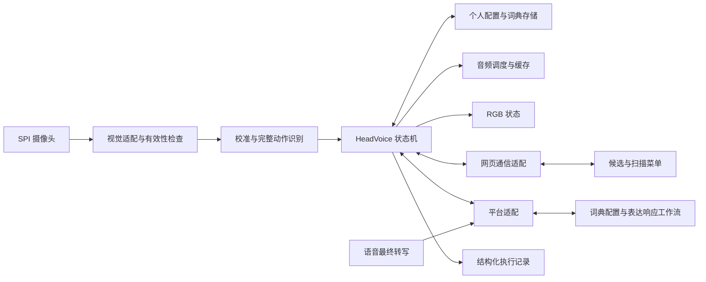
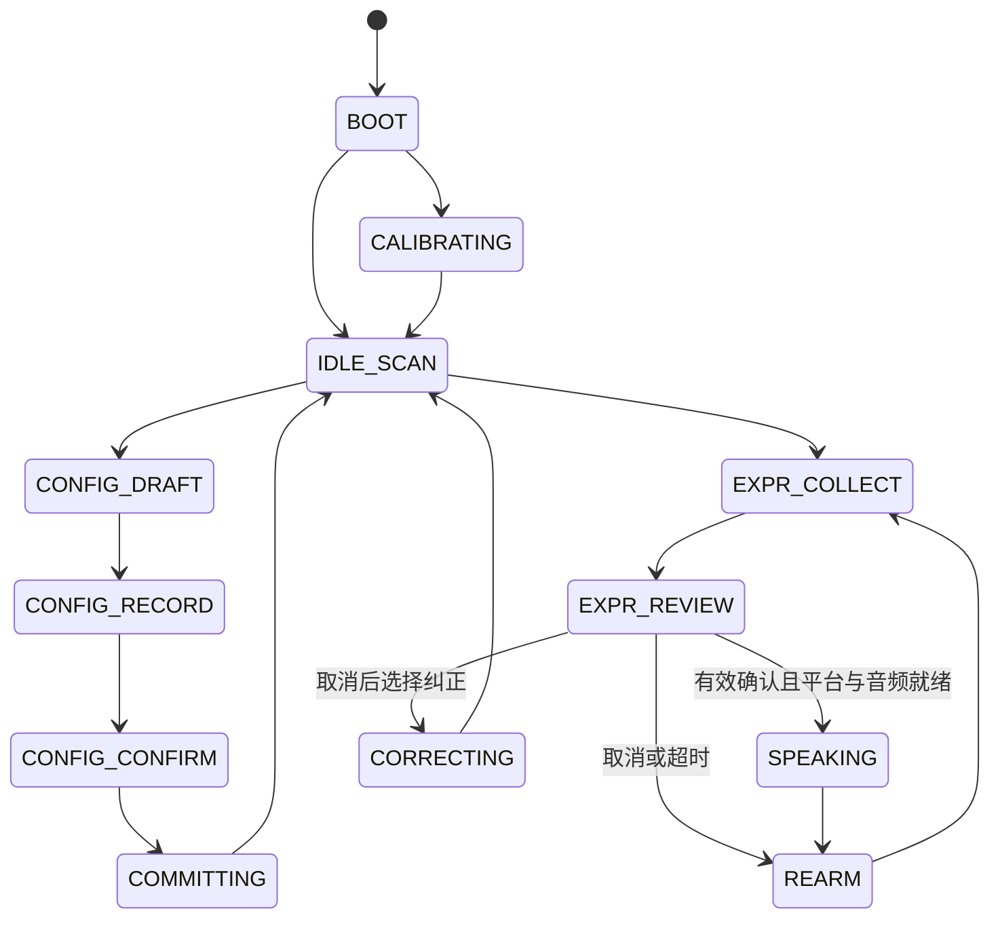

# 颔语 HeadVoice 软件开发文档

版本：v1.0  
日期：2026-10-24  
状态：开发设计，尚未实现或通过实机验收  
适用代码基线：`ljyd_xjwb03_agent_public_developer`，提交 `89020f5e04bf777ae1672b8f3d320bc6e0ef3e0c`

## 1. 目标、范围与完成条件

HeadVoice 将使用者自定义的头部动作组合映射到已经确认的句子，经使用者再次确认后正式播报。家人可以协助拟定词条，使用者也可以通过扫描菜单独立选择、拼句、绑定、修改和取消。

需求依据是 [AI硬件黑客松-双方案完整实现方案.md](/Users/emt/Workspace/hackathon/AI硬件黑客松-双方案完整实现方案.md) 中的 HeadVoice 及共用开发安排。本轮只展开 HeadVoice；共用模块应保留供 ExitCoach 复用的边界。开发按依赖和验证结果推进，不沿用原方案中的现场小时排期。

本文区分四种信息：**需求**来自用户方案；**设计决定**是本版推荐实现；**已核实**仅表示当前源码或文件中存在；**待验证**需要平台账号、编译或实机结果。本文出现的 `hv.*` 消息、模块名和接口是项目拟定契约，不是官方平台已开放的 API。

### 1.1 功能范围

| ID | 需求与本版范围 | 完成证据 |
|---|---|---|
| HV-01 | 个人中立姿态校准，选择可重复且可区分的 A、B 两动作 | 实际动作样本及独立重复结果 |
| HV-02 | AA、AB、BA、BB 四种两动作编码；每个动作包含动作、保持、回正 | 编码记录与对应候选句 |
| HV-03 | 家人至少两轮语音设置；文案和语速可修改，家人提交先进入草稿 | 两轮转写、草稿和使用者确认记录 |
| HV-04 | 组合录制三次检查一致性；使用者确认后保存，覆盖前展示旧句 | 三次记录与一次明确提交 |
| HV-05 | 使用者独立通过扫描菜单选句、有限词库拼句并绑定 | 不由家人代选的完整操作 |
| HV-06 | 候选显示、确认、取消、正式播报；AI 不临场改写已确认句子 | 候选、确认与实际音频对应 |
| HV-07 | 单动作扫描作为两个动作无法稳定区分时的备用输入路径 | 单动作下可选择、返回、取消和确认 |
| HV-08 | 遮挡、多人、失踪、过期输入不触发表达；恢复后不拼接旧组合 | 故障注入与实机记录 |
| HV-09 | 保存个人校准、词典版本和已生成音频，重启后恢复 | 重启前后数据与实际播报一致 |
| HV-10 | RGB 表达状态，喇叭承担引导和正式播报 | 设备输出记录及现场观察 |
| HV-11 | 灵机平台的词典配置、表达响应两个工作流真实运行 | 平台请求、响应和设备执行结果 |
| HV-12 | 个人样本库、kNN、拒识、明确标签纠正、版本回退 | 更新前后独立动作评测 |
| HV-13 | 辅助网页：候选、扫描菜单、词典管理、调用时间线 | 网页与设备状态一致 |

基础流程先完成 HV-01～HV-11、HV-13，再接入 HV-12；这是实现顺序，个人学习仍在本项目的软件开发范围内。任意中文拼音扫描键盘、更多表达页、舵机反馈列为扩展，不纳入本版必做。

### 1.2 全程必须成立的约束

1. 没有动作、超时、家人的口头同意，都不能代替使用者确认。
2. 一次动作最多消费一次；进入确认阶段后不能沿用刚完成编码的动作。
3. 正式播报必须对应当前有效的确认、词条和音频版本。
4. 家人或网页编辑得到的是草稿，不能直接覆盖活动词典。
5. 模型预测不是训练真值；只取消候选而没有指出正确类别时，不添加标签。
6. 失去有效追踪、切换个人/模式、重新校准、重启时，旧动作和未执行确认失效。
7. 模拟器成功、平台接受命令、设备接受播放和喇叭实际发声分别记录，不能互相替代。

## 2. SDK 基线及需要补充的能力

SDK 根目录：`/Users/emt/Workspace/hackathon/ljyd_xjwb03_agent_public_developer`。

| 能力 | 已核实的入口 | HeadVoice 需要做什么 |
|---|---|---|
| 启动 | [main.c](/Users/emt/Workspace/hackathon/ljyd_xjwb03_agent_public_developer/apps/main/main.c) | 注册 HeadVoice 服务，接入统一状态机 |
| 摄像头 | [bsp_camera.c](/Users/emt/Workspace/hackathon/ljyd_xjwb03_agent_public_developer/apps/main/peripheral/bsp_camera.c) | 从帧统计扩展为帧交接、图像转换和推理；管理缓冲区所有权 |
| 姿态模型 | [example_pose.c](/Users/emt/Workspace/hackathon/ljyd_xjwb03_agent_public_developer/apps/main/pose/example_pose.c)、[yolo11_pose.cpp](/Users/emt/Workspace/hackathon/ljyd_xjwb03_agent_public_developer/apps/main/pose/yolo11_pose.cpp) | 将静态 `bus.jpg` 示例替换为连续输入；暴露方向、有效性和人数 |
| 模型配置 | [sdkconfig](/Users/emt/Workspace/hackathon/ljyd_xjwb03_agent_public_developer/apps/sdkconfig)、[coco_pose 构建配置](/Users/emt/Workspace/hackathon/ljyd_xjwb03_agent_public_developer/apps/main/pose/private/coco_pose/CMakeLists.txt) | 当前 V1 文件的输入元数据为 `[1,192,192,3]`；真实延迟和准确性待测 |
| 功能开关 | [qm_config.h](/Users/emt/Workspace/hackathon/ljyd_xjwb03_agent_public_developer/apps/main/qm_config/qm_config.h) | 当前姿态为 1、摄像头为 0；改开关不等于完成实时链路 |
| 语音和会话 | [agent_app.h](/Users/emt/Workspace/hackathon/ljyd_xjwb03_agent_public_developer/apps/main/agent/agent_app.h)、[agent_app.c](/Users/emt/Workspace/hackathon/ljyd_xjwb03_agent_public_developer/apps/main/agent/agent_app.c) | 接收最终转写和播放状态；区分配置对话、操作引导、正式表达 |
| 文件播放 | [playback.h](/Users/emt/Workspace/hackathon/ljyd_xjwb03_agent_public_developer/apps/main/lj_components/playback/playback.h) | 已有本地 PCM、URL 播放及停止入口；需补词条缓存、播放凭据和完成确认 |
| 物模型/业务消息 | [ljyd_method.h](/Users/emt/Workspace/hackathon/ljyd_xjwb03_agent_public_developer/apps/main/cloud/ljyd_method.h)、[ljyd_method.c](/Users/emt/Workspace/hackathon/ljyd_xjwb03_agent_public_developer/apps/main/cloud/ljyd_method.c) | 扩展 HeadVoice 上下行适配；平台能否发送自定义业务消息待核实 |
| 本地 KV | [qm_kv.h](/Users/emt/Workspace/hackathon/ljyd_xjwb03_agent_public_developer/qumios-dev/components/qm_db/include/qm_kv.h) | 小型元数据存储可复用；一致性、容量和断电恢复需要测试 |
| RGB | [bsp_ws2812.h](/Users/emt/Workspace/hackathon/ljyd_xjwb03_agent_public_developer/apps/main/peripheral/bsp_ws2812.h) | 接入状态映射，由单一输出模块控制 |

特别注意：当前 `yaw=abs(dx)/eye_w`、`roll=abs(dy)/eye_w` 是二维关键点比例，不是有方向的头部角度。当前结果主要分析第一个人体，公开结果结构未包含人数。不得直接把这两个字段当作“向左/向右转头”，也不能据它认定已经处理多人场景。

## 3. 总体架构和技术选择

### 3.1 职责分配

**设计决定：设备保存活动个人配置、词典和确认状态，是执行的最终依据。** 平台理解配置语言、校验词条并运行工作流；辅助网页显示状态和提交草稿。平台或网页都不能跳过设备上的确认检查。



| 层 | 推荐实现 | 边界 |
|---|---|---|
| 设备核心 | 可在电脑编译的纯 C 状态、编码、词典与校验模块 | 不直接依赖摄像头、网络或 FreeRTOS；时间与输入由外部传入 |
| 设备适配 | C/C++，复用 ESP-IDF/QUMIOS 和现有模型 | 执行 I/O，转换事件，不擅自改变词典 |
| 个人学习工具 | Python 进行特征分析与离线验证，小型分类器再移植至设备 | 不把电脑推理默认为最终运行依赖 |
| 网页 | TypeScript，推荐 React＋Vite | 根据设备快照渲染；本地按钮不伪造使用者头部确认 |
| 开发桥接 | TypeScript 本地服务＋串口适配 | 为网页与设备提供通信；不承载默认视觉推理 |
| 平台 | 灵机硬件智能体和两个工作流 | 具体传输、结构化输出及精确 TTS 接口需先核实 |

框架版本在创建工程时锁定并记录。以上是选型，不表示项目已安装这些依赖。

### 3.2 可以先于硬件开发的内容

- 核心状态机、AA/AB/BA/BB 编码器、草稿与提交校验、版本与恢复逻辑。
- 网页扫描菜单、词典编辑、大字候选、模拟事件时间线。
- 平台工作流输入输出约定、模拟响应、错误码和验收用例。
- 对已采集特征的分类、回放和评测工具。

摄像头实时性、左右特征可分性、真实停声、播放起始延迟和多人/遮挡检测必须上板验证。模拟事件只能验证后半段逻辑。

## 4. 核心使用流程

### 4.1 首次启动与个人校准

1. 读取配置和词典，校验格式、完整性与版本；损坏时进入恢复界面，不能自动格式化已有数据。
2. 无有效校准时进入引导。先建立一个可重复的选择动作 `S`，供扫描菜单和后续校准使用。
3. 在引导时段采集中立、动作和回正。初次可由家人协助启动采样、标注动作类别，但这不等于使用者确认词典。
4. 用新的动作试做验证 `S`。未建立可靠输入前，仅允许诊断与草稿编辑，不能把家人代操作当作自主设置成功。
5. 使用者通过 `S` 扫描选择候选 A、B，分别采集完整动作及自然活动负样本；独立验证后启用双动作模式。
6. A、B 不可稳定区分时保留单动作扫描模式。重新校准必须先显示影响并确认，旧校准保留供恢复。

`S` 是菜单控制所用的稳定输入配置，可复用已验证的 A；其版本独立固定。分类器更新期间不同时替换 `S`，避免错误模型让使用者失去取消和纠正入口。

### 4.2 家人语音协助配置

1. 使用者进入“词典设置”，家人再发起语音输入。仅待机闲聊不自动进入录制或写词典。
2. 平台形成句子和播报参数草稿；例如第一轮给句子，第二轮选择保留原话、调整语速。
3. 设备和网页显示完整草稿。引导播报须明确说“候选句是……”，不能让旁人误以为已经代表使用者正式表达。
4. 使用者选择目标编码；覆盖已有编码时同时展示旧句与新句。
5. 使用者录制目标组合三次。每次均包含两个完整动作；不一致时指出哪次失败，可重录或取消。
6. 精确音频准备完成、容量预检通过后，设备冻结草稿摘要并进入保存确认；使用者做一次新的确认动作后提交。音频可在草稿稳定后并行准备，文案或语速改变则废弃旧准备结果。
7. 持久化并读回成功才提示“已保存”。平台同步状态单独显示。
8. 清除录制事件，等待回正，使用者再做一次新组合验证表达。

### 4.3 使用者自主设置

待机菜单循环显示“开始表达／自主设置／重新校准／结束”。进入自主设置后可选择整句，也可依次选择“主语/意愿—时间—事项”等有限语义积木。每一级均提供“返回”“取消”，最终展示完整句子后再选择编码、录制三次和确认保存。

不能仅提供家人可点击的网页表单而声称完成自主设置。验收时须通过头部输入走完选择、纠错、绑定和播报。

### 4.4 表达流程

1. 进入表达模式、回正后布防。
2. 收到第一个完整 A/B 动作，开始组合计时；第二个完整动作到达后得到编码。
3. 从活动词典生成本地候选，立即显示；同时触发表达响应工作流校验个人、编码、词典版本和原句。
4. 显示候选后重新等待中立状态，才接受一次新的确认或取消动作。
5. 只有使用者已确认、平台返回匹配的原句、对应音频可用，才能正式播报。
6. 播报结束后再次等待回正，再开始下一句。播报期间采集到的 A/B 不进入下一句。

若平台校验未完成，明确显示“正在核对”，不把等待解释为取消或确认。请求超时后取消本次待播，不在网络恢复时自动播出。

### 4.5 单动作扫描模式

单动作模式下，使用 `S` 选择当前菜单项；词条选择和“确认／取消／返回”均通过扫描完成，不要求使用者再做第二种动作。无动作只继续轮播。

单动作模式的绑定对象是词条槽位，AA/AB/BA/BB 仅作内部槽位标识，不要求使用者做出不可区分的两动作编码。双动作流程中的“三次组合录制”在此替换为三次完整选择动作检查，随后仍需单独确认文案与槽位。两个模式分别记录验收结果；单动作路径通过不能代替 HV-02 的四组合验收。

扫描选择绑定**动作起始时**的菜单项：设备检测到可能的 `S` 起始后冻结该项，待保持和回正完成后确认选择；动作失败则解除冻结。菜单页、项目 ID、扫描代数必须同时匹配。动作恰好跨越切项边界且无法确定指向时拒绝本次选择，不能猜测。

网页只显示设备决定的扫描状态。进入新页面或新候选时等待网页确认已显示，再接收选择；显示断开则暂停依赖网页的扫描。纯语音扫描可作为明确选择的另一种显示模式单独验收，不能在网页断开时悄悄切换。

## 5. 状态机与事件处理

### 5.1 产品状态

| 状态 | 接受的主要输入 | 行为与退出 |
|---|---|---|
| `BOOT` | 存储/设备初始化结果 | 成功后进入 `IDLE_SCAN` 或 `CALIBRATING` |
| `CALIBRATING` | 引导采样、选择、取消 | 新校准验证成功后回待机，失败保留旧版 |
| `IDLE_SCAN` | 菜单选择 | 进入表达、自主设置、重校准或暂停 |
| `CONFIG_DRAFT` | 平台草稿、扫描编辑、取消 | 使用者选定文案和编码后进入录制 |
| `CONFIG_RECORD` | 完整 A/B 动作，或扫描模式的 S | 三组编码一致，或三次选择动作合格后，等待资源就绪再进入保存确认；不写活动词典 |
| `CONFIG_CONFIRM` | 新的确认/取消动作 | 确认绑定草稿摘要后进入 `COMMITTING` |
| `COMMITTING` | 存储结果 | 成功回待机；失败回可重试草稿，活动版本不变 |
| `EXPR_COLLECT` | 完整动作、组合超时、返回 | 编码完成进入候选核对；扫描模式改为选择词条 |
| `EXPR_REVIEW` | 平台结果、显示回执、确认、取消 | 满足所有播报条件后进入 `SPEAKING` |
| `SPEAKING` | 播放开始/完成/失败、暂停 | 完成进入 `REARM`；失败显示结果，不自动重播 |
| `REARM` | 中立稳定 | 清空旧事件后回表达或待机 |
| `CORRECTING` | 选择错误动作、正确类别、确认 | 候选模型验证后激活或保留旧版 |
| `TRACKING_PAUSED` | 追踪恢复、使用者继续 | 清空半组合和待播确认；主动恢复后重新布防 |
| `PAUSED` | 使用者继续、结束 | 停止输出并清空临时输入；继续须重新布防 |



图仅展示主路径；表格和下述全局规则定义异常路径。

### 5.2 动作状态与上下文消费

底层动作状态为 `NEUTRAL → MOVING → HOLDING → RETURNING → COMPLETE`。只有保持合格且回正后才生成一个 `ActionCompleted`。长时间保持不重复生成动作；中途追踪无效或超过最大间隔即取消本动作。

`ActionCompleted` 必须带 `action_id`、`input_epoch`、起止时间、类别、质量及校准/分类器版本。产品状态机按上下文解释同一动作：

- 表达收集：A/B 是编码字符。
- 候选或保存确认：默认 A 是确认、B 是取消；界面须明确显示。刚完成编码的动作不可复用。
- 扫描菜单：`S` 是选择当前冻结项。
- 录制：A/B 只进入当前录制轮次。
- 播放、提交、追踪暂停：A/B 不进入新的编码；允许独立暂停/停止控制。

进入新输入阶段时递增 `input_epoch`、清空旧事件并要求中立。对于相同 `action_id`，只消费一次。

控制入口按状态单独路由：播放时固定选择动作 `S` 表示暂停，不能同时被解释为编码；暂停后通过扫描“继续／结束”恢复或退出。追踪暂停时先恢复有效单人追踪，再开放这两个选项。网页也提供立即暂停按钮，恢复由使用者选择。双动作表达页连续 15 秒未开始动作时返回待机扫描；半组合超过 5 秒也清空并返回待机，便于通过菜单退出。这里的自动返回仅改变导航状态，不代表选择、保存或同意。以上超时均可按个人调整。

### 5.3 全局优先级与计时

优先处理暂停/结束、失效追踪与模式切换，再处理取消，最后处理普通动作和平台响应。暂停须能中止引导与正式播报；恢复必须由使用者发起。

计时使用设备单调时钟。姿态保持依据有效帧的采集时间，不用网络接收时间；帧过旧、序号倒退或中间大段缺帧时不能靠墙钟把保持时间补满。

下列数值仅是调试初值，必须依据个人动作和实测推理频率调整：

| 参数 | 初值/范围 | 处理 |
|---|---|---|
| 菜单扫描 | 2～4 s/项 | 来自原方案，允许使用者调整 |
| 动作保持 | 600～1000 ms | 设计初值；不得要求超出舒适动作范围 |
| 回正稳定 | 300 ms | 新阶段与新动作均需满足 |
| 最大有效帧间隔 | 400 ms | 超过即取消保持；低帧率时先调整识别路径，不伪造连续观察 |
| 保持段最少有效观察 | 3 帧 | 同时满足持续时间与观察数量 |
| 两动作间隔上限 | 5 s | 从第一动作完成计时，超时清空组合 |
| 候选/保存确认期限 | 15 s，可调 | 超时取消，不保存、不播报 |
| 平台响应期限 | 5 s，可调 | 超时作废请求；迟到响应不可重新激活 |

## 6. 视觉、校准和动作特征

### 6.1 帧与缓冲区

采集任务只负责取得帧、记录采集时间和交接。推理任务使用有上限的最新帧槽，忙时丢弃旧帧而不无限排队。借用摄像头缓冲时，在消费者结束前不得归还；若复制到独立缓冲，复制完成后立即归还。异常路径同样必须释放或归还。

先核对实际像素格式、图像方向和左右镜像，再转换到模型输入。网页镜像显示与算法坐标不能混用；校准时记录安装方向，改变安装方式后旧校准失效。

每帧输出至少包含：帧序号、采集与完成时间、实际人数、选定目标、可见关键点、有效性原因、可用特征。检测为多人或人数未知时禁止产生表达动作；不能把 `front()` 的第一个人体当成唯一使用者。

### 6.2 首版特征策略

优先验证左右侧倾：保留两眼连线的符号，使用相对个人基线的有符号倾斜特征。它表示图像中的倾斜趋势，不能直接命名为真实三维角度。关键点缺失时输出无效，不用上一次结果无限延续。

水平转头需要另外验证鼻、眼、耳等可见关键点的相对关系或专用头部姿态模型。未经验证不启用“左右转头”作为 A/B。只要两种舒适动作可稳定区分，允许使用者选用侧倾组合而不强制某一解剖动作。

保存基线中心、自然波动、舒适动作范围和中立区。进入动作阈值与回正阈值采用不同界限，避免边缘抖动反复触发。校准变化产生新的 `calibration_rev`，旧样本和词典动作绑定须检查兼容性。

### 6.3 三次录制的作用

词条绑定时的三次组合录制用于检查“用户刚才做的组合是否一致”，不等于训练完成，也不等于识别率达标。它与个人分类器的训练样本、独立验证样本分开标记。

## 7. 个人动作分类器与纠正

### 7.1 输入与输出

以完整动作窗口为单位提取特征：相对基线的峰值、方向、幅度、持续时间、变化速度、保持波动、回正残差和有效观察比例。具体维度由 `feature_schema` 固定，训练和设备推理必须一致。

缺失必要特征时拒识，不用 0 冒充测量。分类结果为 `A`、`B`、`NON_COMMAND` 或 `UNCERTAIN`；类别距离或分数不对外包装成经过校准的概率。

### 7.2 初始实现

1. 每类先采集约 5～10 次完整动作及自然活动负样本，标记这是初始试验量。
2. 标准化参数只在训练样本上计算，零方差维度单独处理，不能用验证集拟合。
3. 首版采用小型 kNN，`k=3` 作为调试起点；用距离上限和前两类差距做拒识。
4. 用独立动作选择参数，保留最终冻结版本的测试集；相邻帧或同一动作不得拆到不同集合。
5. 设备实现与电脑实现对相同特征应给出相同类别及容差范围内的距离。

初始资源预算可设为 64 个样本、每个最多 16 个 float 特征，原始特征约 4 KiB；这只是设计上限，不是效果保证，也不包含元数据、标准化参数和历史版本。满额时先提示整理样本或显式替换，不能悄悄删除关键负样本。

### 7.3 纠正流程

取消候选后，菜单提供“重新输入／纠正刚才动作／返回”。进入纠正时列出最近组合的第 1、2 个动作，使用者明确选择要纠正的 `window_id`，再选择 A、B、非指令或不确定。无法唯一定位就不添加样本。

家人的标签是待确认建议。只有使用者确认了动作对象和正确类别，才写入标注库。取消本身不产生正确标签。

新增样本形成候选分类器，旧版继续生效。按预先固定的验证动作和指标比较；数据不足时显示“待验证”，不能宣称新版更好。验证通过、使用者确认启用后，在待机且中立时切换版本并清空旧动作。退化时保留旧版；提供撤销最近一次学习更新，恢复样本集合、标准化参数、阈值和分类器版本。

词典不会因分类器更新自动改写。新版本必须重新检查已绑定组合；不兼容时要求重新验证绑定，不能继续使用看似相同的 A/B 名字掩盖动作语义变化。

## 8. 数据模型与版本

### 8.1 持久对象

| 对象 | 关键字段 | 约束 |
|---|---|---|
| `Profile` | `profile_id`、`schema_version`、安装方向、`input_mode`、`calibration_rev`、`classifier_rev`、扫描设置 | 首版一次激活一个个人配置；多用户并行管理属于扩展 |
| `Calibration` | 基线、尺度、中立/动作阈值、动作语义、采样记录引用 | 不称为真实角度，除非对应模型已验证 |
| `DictionarySnapshot` | `dict_rev`、个人 ID、四个编码槽、完整性校验 | 单次提交完整快照；编码唯一 |
| `Entry` | `entry_id`、编码、原句、`text_hash`、语速/声音设置、音频引用、绑定版本 | 文案或播报设置改变后旧确认失效 |
| `AudioAsset` | `asset_key`、文件校验、格式、字节数、时长、状态 | 音频和文字身份绑定，不按文件名猜对应关系 |
| `LabeledWindow` | 动作 ID、个人/模式、特征版本、特征、原预测、用户标签、确认来源 | 默认不保存原始视频；模型预测不作标签 |
| `ClassifierSnapshot` | 样本引用、标准化参数、k、拒识阈值、版本、验证结果 | 可切换与恢复旧版 |

文字以使用者最终确认的 UTF-8 内容为准，不自动改标点、替换同义词或重新生成。若编辑器需要换行规范化，应先显示最终内容，再计算摘要并确认。`text_hash=SHA256(UTF8(text))`；草稿摘要还覆盖编码、个人、基准词典版本、语速及声音参数。

词条示例仅展示数据结构，`audio_status=pending` 时不允许正式播报：

```json
{
  "schema_version": 1,
  "profile_id": "p-demo-01",
  "dict_rev": 1,
  "entry_id": "entry-aa",
  "code": "AA",
  "text": "我想喝水。",
  "text_hash": "976a48063e29724a7c49c229eb62137a9220551365ae16232d1b6bcb8fbb23ff",
  "speech": {"rate": 0.9, "voice_id": "voice-demo"},
  "binding": {"calibration_rev": 1, "classifier_rev": 1},
  "audio_asset_key": null,
  "audio_status": "pending"
}
```

`rate=0.9` 是项目内部相对语速示例，平台适配必须转换为实际支持的参数，不能直接当作官方参数。

### 8.2 临时对象和确认

`Session` 使用 `boot_id + session_id + input_epoch` 区分重启、会话和输入阶段；重启后不恢复未完成组合、确认或待播任务。

`Draft` 包含 `draft_id`、`base_dict_rev`、完整新内容、覆盖对象、输入模式、三次绑定检查结果和摘要；双动作记录组合，单动作记录槽位与选择动作。`Confirmation` 包含目标 ID、摘要、个人、输入阶段、确认动作 ID 和截止时间。旧版本、过期、取消后到达或属于其他个人的确认一律拒绝。

软件记录的“使用者确认”表示当前配置下的有效输入通道，不是生物身份认证。多人画面必须暂停，不能根据一张脸的位置自动断言是谁在同意。

## 9. 设备、平台和网页接口

### 9.1 统一事件信封

所有事件包含协议版本、消息 ID、设备和启动 ID、个人、会话、输入阶段、类型及负载。设备事件携带单调时间；跨设备/网页分析时保留各自时钟，不直接相减。

```json
{
  "protocol_version": 1,
  "message_id": "msg-demo-001",
  "device_id": "device-demo",
  "boot_id": "boot-demo-01",
  "profile_id": "p-demo-01",
  "session_id": "session-demo-01",
  "input_epoch": 12,
  "type": "hv.expression.request",
  "device_monotonic_ms": 123450,
  "payload": {
    "expression_id": "expr-demo-01",
    "dict_rev": 1,
    "entry_id": "entry-aa",
    "code": "AA",
    "text_hash": "976a48063e29724a7c49c229eb62137a9220551365ae16232d1b6bcb8fbb23ff"
  }
}
```

### 9.2 业务消息

| 方向 | 拟定消息 | 含义 |
|---|---|---|
| 平台/网页 → 设备 | `hv.dictionary.propose` | 提交文案和参数草稿，不直接保存 |
| 设备 → 平台 | `hv.dictionary.committed` | 上报已在设备持久化的词典版本及结果 |
| 设备 → 平台 | `hv.expression.request` | 请求核对已确认词典中的词条 |
| 平台 → 设备 | `hv.expression.resolved` | 返回相同表达 ID、词典版本、原句及摘要 |
| 设备 → 网页 | `hv.state.snapshot` / `hv.state.changed` | 完整状态与带递增版本的变化 |
| 网页 → 设备 | `hv.ui.presented` | 确认菜单/候选已显示；不等于使用者同意 |
| 网页 → 设备 | `hv.control.pause` / `hv.control.resume.request` | 暂停或请求恢复；恢复仍检查当前输入和状态 |
| 设备内部 | `hv.user.confirmed` / `hv.user.cancelled` | 由认可的输入路径生成，普通编辑页面不可伪造 |
| 设备 → 平台/网页 | `hv.execution.result` | 分别报告接受、开始、完成、取消、失败 |

处理结果至少包括 `code`、`message_id`、相关对象 ID 和当前版本。拟定错误码：`INVALID_PAYLOAD`、`STALE_CONTEXT`、`VERSION_CONFLICT`、`CONFIRMATION_REQUIRED`、`TRACKING_INVALID`、`CACHE_NOT_READY`、`STORAGE_FULL`、`PLATFORM_TIMEOUT`、`AUDIO_FAILED`。

消息 ID 去重不能无限占用内存，使用有界近期记录；超过保留范围的旧消息仍受启动/会话/版本检查。涉及持久提交的请求 ID 随提交记录保存。重复提交返回原结果，不重复写词典或播放。

### 9.3 平台工作流

**工作流一：词典配置。** 语音最终转写 → 提取句子、是否保留原话和播报参数 → 返回草稿 → 设备完成组合录制和使用者确认 → 本地保存 → 上报结果并同步平台镜像。

平台不能把家人说“对”当作设备已收到使用者确认。模型只能生成允许字段；设备检查长度、编码、参数范围和版本，拒绝任意工具调用或未定义字段产生的副作用。

**工作流二：表达响应。** 接收表达请求 → 校验个人和词典版本 → 读取已同步原句 → 返回原句与摘要 → 设备逐项比较 → 等待/复核使用者确认 → 播报 → 上报实际执行结果。

原句查询不需要模型改写。平台结果与本地快照不一致时拒绝本次播报并同步，不用平台文本覆盖本地词典。

**在线时序决定：**本地候选可先显示，平台校验并行进行。正式播报同时依赖使用者确认、匹配的平台结果和缓存就绪；如果确认先到，等待平台期间的延迟计入真实响应时间，不能从验收统计中剔除。平台慢时应优化流程或如实记录未达标，不能伪造调用。离线表达可后续增加显式模式，本版不自动绕过工作流。

本地保存成功、平台同步失败时，显示“本地已保存，待同步”；重启仍保留该词典，但在线表达必须先解决版本同步。不得因为平台超时回滚已明确成功的本地提交，也不得声称平台已同步。

### 9.4 网页连接设计

首版开发和演示推荐：浏览器连接电脑上的本地 bridge，bridge 通过设备可用的 USB/调试串口交换结构化消息，设备仍直接连接灵机平台。该 bridge 不承担默认视觉推理，也不取代平台工作流。

这条路径尚未实现，先确认具体串口、双向收发和与 CLI 的共存方式。建议使用带固定前缀的 UTF-8 JSON 行区分业务帧与日志，限制帧长度，并拒绝未知类型；不把串口变成任意命令执行入口。桥接服务绑定本机地址，网页会话配对后才允许控制，平台密钥不进入浏览器或记录文件。

网页状态只以设备快照为准：断开时标记过期并禁用依赖新状态的操作，重连先获取完整快照。扫描的当前位置由设备维护；网页不能独立计时后猜测用户选中了哪一项。UI 断开时已确认且已经开始的音频可正常结束，新候选/依赖网页的选择暂停。

## 10. 音频、反馈与容量

### 10.1 三类音频

- `GUIDANCE`：操作引导，例如“请选择要绑定的组合”。
- `PREVIEW`：带明确前缀的候选回读，例如“候选句：我想喝水。请确认或取消”。
- `EXPRESSION`：使用者确认后，原样播报“我想喝水”。

三类分别记录。不能用已经播放预览音频来证明正式播报成功，也不能把“未经确认正式播报为 0”误实现为完全禁止确认前的操作引导。

播报期间默认停止收集新编码。配置语音中仅消费最终转写，忽略中间识别结果；引导/预览的回声不能作为家人新指令。实际录音门控和回声处理需要联调。

### 10.2 缓存与精确文本

`asset_key` 由原句、声音、语速、合成版本和音频格式共同决定。修改其中任一项必须生成新资源。生成、下载、校验完成后资源才标记 `READY`。

当前文件播放入口支持本地 PCM，优先适配 16 kHz、单声道、16-bit PCM。精确文本 TTS、可下载资源和声音/语速参数均需核实；不能把“向 agent 提交一句话”当作必然逐字合成的保证。开发初期可用人工核对的固定短句音频测试，验收自定义文案时必须完成对应音频生成或明确支持的录入路径。

正式播放前核对表达 ID、个人、词典版本、原句摘要、音频身份、确认有效期和当前状态。以 `expression_id` 做一次性播放凭据；播放失败或状态不明时不自动重试，显示结果后由使用者重新发起。

### 10.3 存储预算

当前 [分区表](/Users/emt/Workspace/hackathon/ljyd_xjwb03_agent_public_developer/apps/partitions.csv) 的 `spiffs_data` 为 1024 KiB。PCM 每秒约 32000 字节，四句各 5 秒约 640000 字节，尚未包含文件系统、旧资源、临时下载和样本文件。不能把整个 16 MB Flash 当作可用音频空间。

保存前检查新旧资源并存所需容量；保留活动词条引用的资源，优先删除未引用缓存。容量不足时拒绝新提交并保留旧词典，不先删除正在使用的音频。压缩音频或调整分区属于后续设计变更，需要验证播放器及升级/恢复流程。

### 10.4 RGB 映射

| 状态 | 颜色/行为 |
|---|---|
| 设置/校准 | 白色低亮或缓慢变化，具体效果可配置 |
| 等待确认 | 黄灯 |
| 正式播报 | 蓝灯 |
| 保存成功 | 绿闪一次 |
| 追踪或设备异常 | 黄灯闪烁，同时给出具体原因 |
| 待机/暂停 | 低亮或熄灭 |

颜色只作辅助，网页和引导音应提供同等含义。所有 RGB 调用通过统一反馈适配，避免多个任务争抢灯态。

## 11. 保存、恢复和并发

### 11.1 保存事务

1. 检查草稿、目标槽位/编码、原词典版本、对应模式的三次绑定检查和使用者确认。
2. 生成候选快照；复核确认前已准备好的音频和存储容量。
3. 写入非活动槽并读回校验。文案、绑定和资源引用必须完整。
4. 在单写入者中再次检查确认未失效、个人/校准/词典版本未变化。
5. 写入提交标记并切换活动快照；读回确认后报告成功。
6. 上报平台并记录同步状态；回收不再被活动或保留版本引用的资源。

持久层使用两份快照与带校验的提交记录。启动只选取完整且已提交的版本，不能因某个暂存文件序号较高就激活它。KV 单键写入及文件系统掉电行为需做故障注入验证；本设计不预设多字段写入天然原子。

第 4～5 步是提交的串行裁决区，与取消、暂停及版本变更共用同一提交锁。若取消先被裁决，候选快照不得激活；若提交已生效，后到的暂停只停止输出，界面应明确词条已经保存，不能显示为取消成功。锁只覆盖最终检查与提交标记，不能覆盖音频生成、下载或大文件写入；长耗时准备阶段保持可取消。

首版同一设备一次激活一个个人配置；切换或导入其他个人配置必须明确操作并清空临时输入。三人测试可以分别导出/恢复配置，不代表已经支持多用户自动识别。

### 11.2 并发分工

| 执行单元 | 工作 | 不应执行的操作 |
|---|---|---|
| 摄像头任务 | 采集、时间戳、交接缓冲 | 网络等待、写 Flash |
| 推理任务 | 特征与有效性 | 直接播放或修改词典 |
| 核心事件循环 | 状态迁移、版本检查、决定动作 | 阻塞等待音频/平台 |
| 音频任务 | 下载/播放/停止和结果事件 | 绕过确认自行正式播报 |
| 存储任务 | 候选持久化、校验 | 自行批准候选 |
| 平台/网页适配 | 校验消息并投递事件 | 在回调中长时间等待 |

控制事件与帧数据分开排队，暂停/失效事件有优先处理通道；队列溢出应清空未完成组合并报告原因，不能丢掉取消却继续执行确认。旧异步回调必须校验 `boot_id/session_id/input_epoch` 及相应版本。

## 12. 代码组织与接口边界

以下目录是拟新增结构，尚未创建。设备目录相对于上述 SDK 根目录；网页和开发工具放在独立的 HeadVoice 项目目录，不混入 ESP-IDF 源码。

```text
apps/main/headvoice/
  core/            状态机、事件、编码、候选和确认校验
  gesture/         基线、动作窗口、特征、kNN、拒识
  dictionary/      词条、草稿、快照和提交
  adapters/        摄像头、音频、RGB、KV、平台、网页消息
  headvoice_app.c  初始化和任务装配

HeadVoice/
  web/             候选、扫描菜单、词典草稿、诊断时间线
  bridge/          本地串口与网页连接
  platform/        两工作流说明、配置导出与脱敏输入输出
  tools/           特征处理、分类器导出、评测报告
  tests/           主机端测试、事件回放、故障脚本
  fixtures/        模拟帧结果、动作轨迹、协议样例
  docs/            接口核实、实机测量、接线与恢复说明
```

核心拟定接口保持小而可替换：

```c
/* 设计接口，非现有 SDK API；类型需在实现阶段定义。 */
hv_result_t hv_core_dispatch(hv_context_t *ctx,
                             const hv_event_t *event,
                             hv_effect_list_t *effects);
hv_result_t hv_gesture_consume(hv_gesture_ctx_t *ctx,
                               const hv_observation_t *observation,
                               hv_action_event_t *out);
hv_result_t hv_dictionary_validate(const hv_draft_t *draft,
                                   const hv_confirmation_t *confirmation,
                                   const hv_snapshot_t *active);
```

`dispatch` 输出待执行效果，例如显示、请求平台、写候选快照、播放或停止；适配器执行后再返回结果事件。核心不假定调用成功就已经发声或持久保存。

集成时为 HeadVoice 增加独立编译开关、源文件清单和初始化入口；按同一宏控制构建与调用。先保留原版工程可构建的基线，再分阶段接入。

## 13. 测试与验收

### 13.1 分层验证

| 层 | 验证方式 | 可以证明什么 |
|---|---|---|
| 核心逻辑 | 主机端纯 C 测试、事件序列回放、虚拟时钟 | 状态、版本、超时、编码和事务规则 |
| 网页/协议 | 模拟设备与平台、重连及乱序消息 | 展示一致性、消息处理、禁止代确认 |
| 视觉/分类 | 保存的完整动作窗口与独立采集 | 特征可分性、分类与拒识；不能证明音频实际输出 |
| 设备集成 | 摄像头、联网、语音同时运行 | 实际速度、内存、播放、RGB 和恢复 |
| 使用流程 | 使用者自行完成操作 | 自主设置与表达是否可用 |

### 13.2 必测用例

| 编号 | 场景 | 期望 |
|---|---|---|
| T01 | AA、AB、BA、BB 各输入一次 | 候选分别对应活动词典 |
| T02 | 动作一直保持不回正 | 不重复产生字符，也不完成动作 |
| T03 | 第一个动作后超过组合期限 | 清空半组合，第二个动作不得拼接旧输入 |
| T04 | 编码最后一个动作延续到确认阶段 | 不构成确认，必须回正后做新动作 |
| T05 | 候选取消或确认超时 | 无正式播报，旧响应后到也无效 |
| T06 | 单动作扫描无动作 | 持续轮播，不默认选择 |
| T07 | 动作开始后菜单即将切项 | 锁定起始项或拒绝歧义，不选中下一项 |
| T08 | 词条覆盖时修改了文案/语速 | 原确认失效，展示新摘要并重新确认 |
| T09 | 三次录制有一次不同或无效 | 不允许提交，支持重录/取消 |
| T10 | 家人说同意、网页直接提交确认 | 不能替代使用者确认 |
| T11 | 遮挡、多人或无有效关键点 | 取消动作与待播确认，暂停并要求重新布防 |
| T12 | 恢复追踪或网络 | 不恢复半组合，不自动播旧句 |
| T13 | 平台返回不同原句/版本 | 拒绝播放，报告版本冲突 |
| T14 | 请求重发、乱序、迟到 | 不重复提交或播放 |
| T15 | 本地保存成功、平台同步失败 | 保留本地数据，显示待同步 |
| T16 | 写快照、写提交标记前后分别断电 | 恢复完整旧版或新版，无半条词典 |
| T17 | 缓存缺失、校验失败或空间不足 | 不播放错误资源，不破坏活动词典 |
| T18 | 播放失败或结果丢失 | 不自动重播，允许使用者重新发起 |
| T19 | 引导音被麦克风拾取 | 不作为新词条或确认指令 |
| T20 | 只取消但未给正确类别 | 不新增带标签样本 |
| T21 | 纠正组合中某一个动作 | 样本关联到准确 window_id，不误标另一动作 |
| T22 | 候选分类器退化或验证不足 | 旧版保持有效，不宣称更新改善 |
| T23 | 撤销学习更新 | 样本、标准化和分类器完整恢复，词典不被改写 |
| T24 | 模式/个人切换时有旧事件与音频 | 清空或取消旧任务，迟到结果不执行 |
| T25 | 网页断开、重连或显示回执过期 | 暂停依赖显示的输入，先同步完整状态 |
| T26 | 使用者独立拼句、绑定、取消、再确认 | 不依赖家人代选，完成一次真实表达 |
| T27 | 单动作模式设置、确认、取消和退出 | 全程只需 S，不进入两动作录制死路 |
| T28 | 保存最终提交与暂停同时到达 | 按串行裁决顺序得到唯一结果，界面与持久状态一致 |

### 13.3 性能与使用目标

以下继承原方案，均为待测目标：

- 至少 3 人，每人每组合 10 次，共至少 120 次组合尝试；按人和编码分别报告正确、错误、拒识。拒识不能从正确率分母中删除，目标正确识别率 ≥90%。
- 每人自然活动 5 分钟，候选误触发目标 ≤1 次；未经有效确认的正式播报为 0 次。
- 组合完成至候选实际显示目标 ≤500 ms；确认至缓存音频实际起播目标 ≤1 s。
- 遮挡不触发，恢复不拼接旧动作，重启保留个人配置、词典和已有有效音频。

测量“组合完成”时，记录使用者完成第二个动作并回正的观察时间，同时记录设备动作完成事件时间。候选显示以实际渲染为终点；音频起播以实际可听输出为终点，不能仅用函数返回时间。跨时钟测量要同步或采用同一外部观察记录，并注明误差。报告中位数、P95、最大值、超时与失败次数；不只展示成功样例平均值。

视觉性能至少测单独推理，以及摄像头、联网、语音并发两种条件。现有 192×192 模型的运行时间不能从 640×640 参考表换算得出。根据实测频率决定动作保持参数；若不够快，调整识别路径后重新验收。

学习效果用更新前后未参与训练的完整动作比较，另报告误触发和拒识变化。一次纠正样本被重新预测正确只能证明记住了该样本，不能作为泛化结果。目标使用者的操作可用性需要单独记录，普通演示者的测试不替代它。

## 14. 开发阶段与交付

| 阶段 | 工作 | 离开本阶段的条件 |
|---|---|---|
| S0 基线核实 | 原版编译、语音联网、摄像头帧、192 模型计时、可用方向特征、精确 TTS/平台接口探测 | 有实际结果和明确接口边界；未通过部分有修复或替代路径 |
| S1 主机端逻辑 | 核心状态、编码、草稿、确认、模拟平台/网页事件 | T01～T10、T13～T15 的模拟逻辑通过 |
| S2 基础表达 | 真实动作、四词条、候选、确认/取消、缓存播放、RGB | 真人走完四个编码及取消路径；记录实际延迟 |
| S3 完整设置 | 两轮家人语音、自主扫描拼句、三次录制、覆盖和恢复 | HV-03～HV-09 全路径，含自主操作与断电检查 |
| S4 平台与网页 | 两工作流、版本同步、串口桥接、完整快照和执行时间线 | 平台有真实调用，模拟/真实记录清晰区分 |
| S5 个人学习 | 样本、kNN、拒识、纠正、验证与回退 | 桌面/设备一致，独立动作评测和退化回退完成 |
| S6 完整验收 | 并发、异常、三人测试、目标使用流程、交付材料 | 需求逐项有证据，未达项明确列出 |

S1 和网页原型可与 S0 并行；模拟平台不能替代 S4，静态图片不能替代 S2。阶段顺序用于控制依赖，不承诺固定天数。

每阶段交付源码、配置版本、可复现步骤和实际测试记录。最终交付包括固件与构建说明、网页/bridge、两工作流导出或截图、词典/模型格式说明、接口核实表、第三方组件说明、接线与恢复说明、演示脚本和验收报告。赛事标签与交付时间在执行时另核对，不把文档里的旧通知视作最新规则。

## 15. 尚待核实的接口与决策

| 问题 | 如何核实 | 未确认时的边界 |
|---|---|---|
| 192×192 模型的实际速度和特征质量 | 摄像头输入并发语音实测 | 不承诺 500 ms 或稳定 A/B |
| 是否可得到可靠人数、方向和关键点质量 | 修改视觉输出并做单人/多人/遮挡测试 | 无有效信息时拒绝输入 |
| 平台能否发送/接收自定义结构化消息 | 实际账号建立最小请求与回执 | 只用模拟器开发，不能宣称平台接通 |
| 精确原句 TTS 和资源下载 | 固定原句、标点、语速生成与听测 | 固定录音可做底层测试，自定义文案能力仍未完成 |
| 自定义角色配置对话是否会绕过确认自行播出原句 | 平台与音频通路联调 | 必须区分候选引导和正式表达，无法控制则更换合规接入路径 |
| 串口业务帧与 CLI/日志是否能共存 | 单端口双向测试及错误帧测试 | 使用专用适配，避免多个程序同时占用串口 |
| 缓存与样本能否放入现有分区 | 统计新旧资源并存峰值，做满盘测试 | 容量不足拒绝新写入，不自动改分区 |
| KV/文件更新的掉电恢复 | 每个提交步骤故障注入 | 未验证前不报告持久化可靠性通过 |

## 16. 来源与文档维护

- 产品需求：[AI硬件黑客松-双方案完整实现方案.md](/Users/emt/Workspace/hackathon/AI硬件黑客松-双方案完整实现方案.md)。
- SDK 事实：第 2 节和各节链接所指的当前源码；提交号见文首。
- 核查与模型元数据依据：[HeadVoice/ExitCoach 代码缺口记录](/Users/emt/Workspace/uni_vault/06_LLM_Wiki/records/hackathon/HeadVoice_ExitCoach_代码缺口_2026-10-24.md)。
- 会话决定：2026-10-24 用户说明时间相对宽裕、两方案均可推进，并要求先撰写 HeadVoice 软件开发文档。

开发中以本文件维护 HeadVoice 软件契约；实际进度、测量和待解决问题写入项目记录，避免把“设计完成”改写成“功能完成”。新增实现必须更新受影响的接口、状态和测试映射；平台接口验证后用真实名称补充适配表，但保留内部契约与官方接口的区别。
